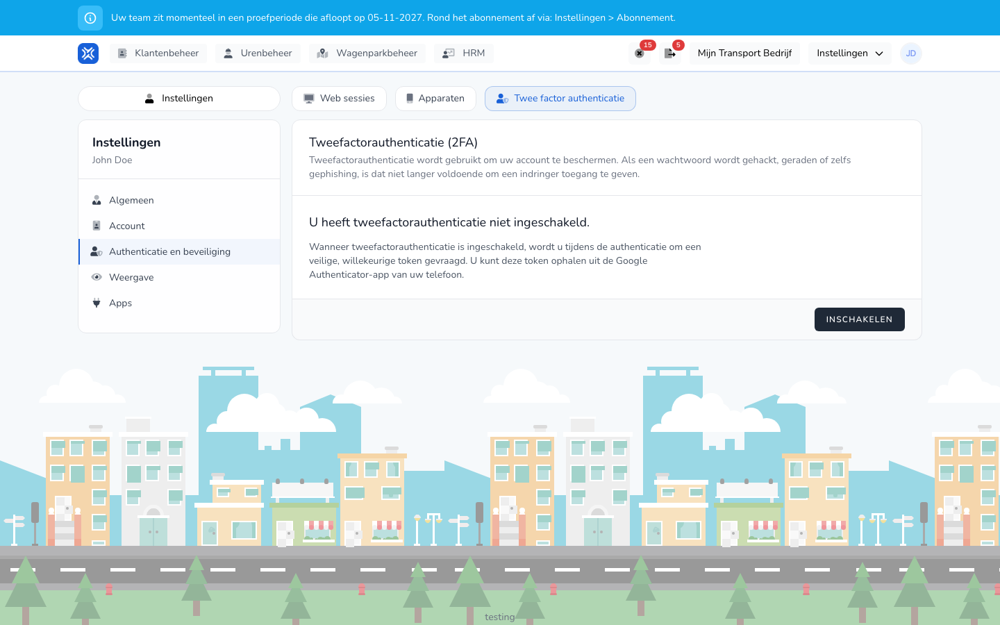

import { Hint } from '/snippets/hint.jsx';

## Waar deze pagina voor is

Hier ziet u waar u bent ingelogd, trekt u gekoppelde apparaten in en zet u tweefactorauthenticatie aan.

## Schermafbeelding

## Wie dit mag gebruiken

- Iedere gebruiker, voor het eigen account.

## Zo gebruikt u deze pagina

Andere sessies uitloggen:

1. Klik rechtsboven op uw initialen en kies **Instellingen** → **Authenticatie en beveiliging**.
2. Klik op **Web sessies** op **Andere browser sessies uitloggen**.
3. Vul uw **Wachtwoord** in en bevestig.

Een apparaat intrekken:

1. Open het tabblad **Apparaten**.
2. Klik op **Intrekken** bij het apparaat en bevestig met uw wachtwoord.

Tweefactorauthenticatie aanzetten:

1. Open het tabblad **Twee factor authenticatie** en klik op **Inschakelen**.
2. Scan de QR-code met een authenticator-app op uw telefoon, zoals Google Authenticator. Of kopieer de **Instelsleutel** naar de app.
3. Vul de 6-cijferige **Authenticatorcode** uit de app in en klik op **Installatie bevestigen**.
4. Bewaar de herstelcodes op een veilige plek. <Hint kind="red">Met een herstelcode komt u in uw account als u uw telefoon kwijt bent. Zonder herstelcode lukt dat niet.</Hint>

## Velden

| Tabblad | Wat u ziet |
|---------|------------|
| **Web sessies** | Waar u nu bent ingelogd, met **Dit apparaat** en wanneer elke sessie voor het laatst actief was. |
| **Apparaten** | De apparaten, zoals de app, die op uw account zijn aangemeld, met het aantal actieve sessies. |
| **Twee factor authenticatie** | Of tweefactorauthenticatie aan staat, met **Toon herstelcodes**, **Herstelcodes opnieuw genereren**, **QR-code tonen** en **Uitschakelen**. |

## Wat er daarna gebeurt

- Met tweefactorauthenticatie vraagt TransportKlok bij het inloggen ook om een code uit de app.
- Na het aanzetten wordt u op uw andere apparaten en browsers uitgelogd. Daarna logt u daar opnieuw in met de code.
- Een ingetrokken apparaat moet opnieuw inloggen.

## Beperkingen

- Voor herstelcodes, de QR-code en uitschakelen vraagt TransportKlok eerst uw wachtwoord.
