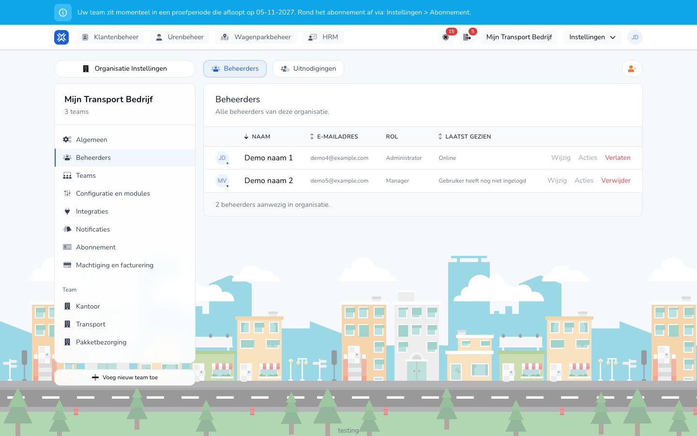

import { Hint } from '/snippets/hint.jsx';

## Waar deze pagina voor is

Hier beheert u wie uw organisatie beheert: de beheerders en managers. Medewerkers die alleen uren registreren, beheert u bij [Arbeidskrachten](/beheerders/personeelszaken/personeel/overzicht).

## Schermafbeelding

## Wie dit mag gebruiken

- Een beheerder van de organisatie.

## Zo gebruikt u deze pagina

Iemand uitnodigen:

1. Open **Instellingen** → **Organisatie Instellingen** → **Beheerders**.
2. Klik rechtsboven op de knop met het persoon-plus-pictogram.
3. Vul het **E-mail** in, kies de **Rol** en, als u meer teams hebt, de **Teams**.
4. Klik op **Uitnodigen**.

Iemand wijzigen of verwijderen:

1. Klik op het tabblad **Beheerders** op **Wijzig** in de rij van de persoon.
2. Pas op **Gegevens** de **Volledige naam** aan, of op **Rechten** de **Rol** en de **Teams**, en klik op **Opslaan**.
3. Klik op **Verwijder** om iemand uit de organisatie te halen, en bevestig.

## Velden

| Kolom | Betekenis |
|-------|-----------|
| **Naam** | De naam van de beheerder of manager. |
| **E-mailadres** | Het e-mailadres waarmee de persoon inlogt. |
| **Rol** | **Administrator** of **Manager**. |
| **Laatst gezien** | **Online**, hoe lang geleden de persoon actief was, of **Gebruiker heeft nog niet ingelogd**. |

Bij een uitnodiging:

| Veld | Wat u invult |
|------|--------------|
| **E-mail** (verplicht) | Het adres waar de uitnodiging naartoe gaat. |
| **Rol** (verplicht) | **Administrator** of **Manager**. |
| **Teams** | De teams waar de persoon bij kan. Minstens één. Dit veld ziet u als uw organisatie meer dan één team heeft. |

Wat een rol mag:

| Rol | Wat deze rol mag |
|-----|------------------|
| **Administrator** | De volledige organisatie beheren: alle instellingen, beheerders, abonnement en facturen, en alles wat een manager mag. |
| **Manager** | Tijdregistraties bekijken, goedkeuren, afkeuren, aanmaken en exporteren, voor de teams waar de manager bij hoort. |

Een medewerker krijgt hier geen rol. Een medewerker doet eigen tijdregistraties en krijgt een account als u de medewerker aanmaakt met een account. Zie [Arbeidskracht aanmaken](/beheerders/personeelszaken/personeel/aanmaken).

## Wat er daarna gebeurt

- De uitnodiging staat op het tabblad **Uitnodigingen** tot die is geaccepteerd. Daar kunt u hem **Verstuur opnieuw** of **Annuleren**.
- Na het accepteren staat de persoon op het tabblad **Beheerders**.
- Met **Verlaten** in uw eigen rij verlaat u zelf de organisatie.
- De rechten volgen direct uit de rol. U zet geen losse rechten per persoon aan of uit.
- Met **Teams** beperkt u een manager tot bepaalde teams. Kiest u alle teams, dan geldt de rol voor de hele organisatie.

## Beperkingen

- Een organisatie houdt altijd minstens één beheerder. <Hint kind="red">De laatste beheerder kunt u niet verwijderen.</Hint>
- Uw eigen rol en teams kunt u niet zelf wijzigen.
- Een manager ziet het menu **Organisatie Instellingen** niet.
- Een e-mailadres dat al een uitnodiging heeft of al bij de organisatie hoort, kunt u niet nog eens uitnodigen.
