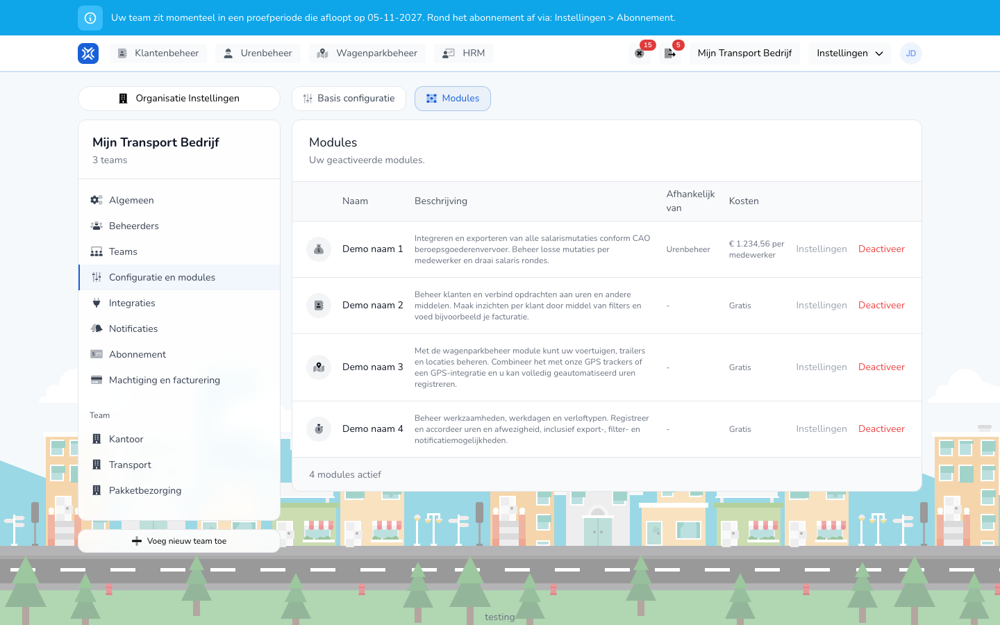

import { Hint } from '/snippets/hint.jsx';

## Waar deze pagina voor is

Hier stelt u in hoe TransportKlok voor uw hele organisatie werkt, en zet u modules aan of uit.

## Schermafbeelding

## Wie dit mag gebruiken

- Een beheerder van de organisatie.

## Zo gebruikt u deze pagina

De basisconfiguratie:

1. Open **Instellingen** → **Organisatie Instellingen** → **Configuratie en modules**.
2. Pas op het tabblad **Basis configuratie** de instellingen aan, zoals **Bestandstype data exports**.
3. Klik op **Opslaan**.

Modules:

1. Open het tabblad **Modules**.
2. Klik op **Voeg module toe** en kies **Activeer** bij een module, of klik op **Deactiveer** bij een actieve module.
3. Kies in het venster of de wijziging direct ingaat of vanaf de volgende abonnementsperiode.
4. Klik bij een module op **Instellingen** om de instellingen van die module te wijzigen, en klik op **Opslaan**.

## Velden

De modules:

| Module | Wat het doet |
|--------|--------------|
| **Urenbeheer** | Werkzaamheden, werkdagen en verloftypen beheren, en uren en afwezigheid registreren en goedkeuren. |
| **Klantenbeheer** | Opdrachtgevers beheren en aan uren koppelen. |
| **Wagenparkbeheer** | Voertuigen, trailers en locaties beheren, met trackers of een GPS-koppeling. |
| **Salarismutaties** | Salarisrondes draaien en salarismutaties exporteren. Werkt samen met **Urenbeheer**. |

In de kolom **Kosten** ziet u per module of die **Gratis** is of wat die per medewerker kost. <Hint kind="yellow">Welke modules u kunt aanzetten, hangt af van uw abonnement.</Hint>

Instellingen per module, onder **Instellingen**:

| Module | Instellingen |
|--------|--------------|
| **Urenbeheer** | Of medewerkers zelf tijdregistraties aanmaken, of goedkeuring wordt overgeslagen, handmatige en concept-tijdregistraties, en de tijdstapgrootte. |
| **Klantenbeheer** | Of u tijdens het registreren een opdrachtgever kunt aanmaken. |
| **Salarismutaties** | De loonsverwerkingsperiode, de startdag, het formaat van de salarisexport en de periode van de variabele salariscomponenten. <Hint kind="yellow">Dit hangt af van de CAO of de contractinstelling: stem deze instellingen af met uw salarisadministratie.</Hint> |

## Wat er daarna gebeurt

- Een geactiveerde module verschijnt in het menu. Tijdens de proefperiode gebruikt u een module gratis.
- Zet u een module uit per volgende periode, dan ziet u tot dan "Deze module zal vanaf … niet meer beschikbaar zijn." Met **Annuleer deactivatie** of **Annuleer activatie** draait u een geplande wijziging terug.

## Beperkingen

- Een module die een andere module nodig heeft, staat met die module in de kolom **Afhankelijk van**.
- Het tabblad **Integraties** van deze pagina staat beschreven bij [Integraties](/beheerders/instellingen/organisatie/integraties).
