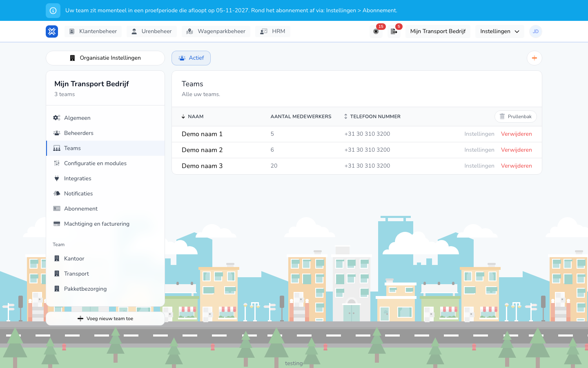

import { Hint } from '/snippets/hint.jsx';

## Waar deze pagina voor is

Een team is een groep arbeidskrachten met eigen instellingen, zoals werkzaamheden en sjablonen. Hier maakt u teams aan en opent u hun instellingen.

## Schermafbeelding

## Wie dit mag gebruiken

- Een beheerder van de organisatie.
- Teams ziet u als uw organisatie meer dan één team heeft en het abonnement **Plus** of **Pro** is. <Hint kind="yellow">Een team aanmaken, verwijderen of herstellen kan met een actief **Plus**- of **Pro**-abonnement of tijdens de proefperiode.</Hint>

## Zo gebruikt u deze pagina

1. Open **Instellingen** → **Organisatie Instellingen** → **Teams**.
2. Klik op **Instellingen** in de rij van een team om de teaminstellingen te openen.
3. Klik op **Voeg nieuw team toe** om een team te maken. Vul de **Naam** in en klik op **Aanmaken**.
4. Klik op **Verwijderen** om een team weg te halen, en bevestig in het venster **Team verwijderen**.

## Velden

| Kolom | Betekenis |
|-------|-----------|
| **Naam** | De naam van het team. |
| **Aantal medewerkers** | Hoeveel arbeidskrachten bij het team horen. |
| **Telefoon nummer** | Het telefoonnummer van het team. |

Bij een nieuw team vult u alleen de **Naam** in. Die moet uniek zijn binnen uw organisatie.

## Wat er daarna gebeurt

- Na **Aanmaken** komt u in de instellingen van het nieuwe team. Het team krijgt de standaardinstellingen van uw CAO.
- Een verwijderd team staat in de **Prullenbak**. Met **Herstellen** haalt u het terug.

## Beperkingen

- Welke arbeidskrachten bij een team horen, stelt u in bij de arbeidskracht. Zie [Teams van een arbeidskracht](/beheerders/personeelszaken/personeel/teams).
