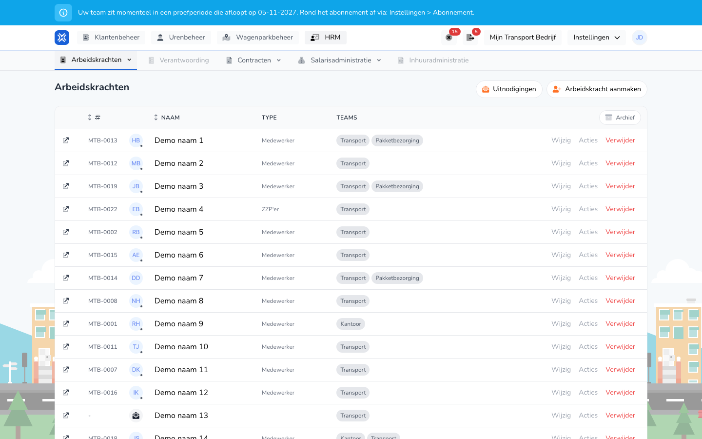

import { Hint } from '/snippets/hint.jsx';

## Waar deze pagina voor is

Hier ziet u wie er voor uw organisatie werkt: medewerkers in loondienst, zzp'ers en charters. Vanuit dit overzicht maakt u een arbeidskracht aan, past u gegevens aan en nodigt u mensen uit.

## Schermafbeelding

## Wie dit mag gebruiken

- Een beheerder of manager van de organisatie. <Hint kind="grey">Een manager ziet alleen de arbeidskrachten van de teams die de manager beheert, en arbeidskrachten zonder team.</Hint>

## Zo gebruikt u deze pagina

1. Open **HRM** en kies **Arbeidskrachten**.
2. Zoek de arbeidskracht in de lijst. Onder de naam staat het e-mailadres, of **Geen account** als de arbeidskracht niet inlogt.
3. Klik op het pictogram vóór de regel om de details te openen. Zie [Arbeidskracht weergeven](/beheerders/personeelszaken/personeel/details).
4. Klik op **Wijzig** om gegevens aan te passen. Zie [Arbeidskracht wijzigen](/beheerders/personeelszaken/personeel/wijzigen).
5. Klik op **Arbeidskracht aanmaken** om iemand toe te voegen. Zie [Arbeidskracht aanmaken](/beheerders/personeelszaken/personeel/aanmaken).
6. Klik op **Uitnodigingen** voor de openstaande uitnodigingen. Zie [Uitnodigingen](/beheerders/personeelszaken/personeel/uitnodigingen).

## Velden

| Kolom | Betekenis |
|-------|-----------|
| Personeelsnummer | Het personeelsnummer, bijvoorbeeld MTB-0013. |
| **Naam** | De naam, met daaronder het e-mailadres of **Geen account**. |
| **Type** | **Medewerker**, **ZZP'er** of **Charter**. |
| **Teams** | De teams waar de arbeidskracht bij hoort. |

Onder **Acties** vindt u per regel:

- **Details weergeven**
- **Wijzig contracten**
- **Wijzig team(s)**
- **Kopier uitnodiging**, als de arbeidskracht een openstaande uitnodiging heeft.

## Wat er daarna gebeurt

- **Verwijder** vraagt om bevestiging in het venster **Medewerker verwijderen** en haalt de arbeidskracht daarna uit uw organisatie. <Hint kind="yellow">Tijdens een proefperiode gebeurt dat direct. Met een betaald abonnement blijft de arbeidskracht tot het einde van de abonnementsperiode; tot dan staat er een oranje uitroepteken met de datum, en kunt u het verwijderen met **Annuleren** terugdraaien.</Hint>
- Met **Archief** ziet u arbeidskrachten die uit uw organisatie zijn gehaald. Met **Voeg opnieuw toe** haalt u iemand terug.

## Beperkingen

- Het overzicht heeft geen filters en geen zoekveld.
- Teams die u niet beheert, ziet u niet.
