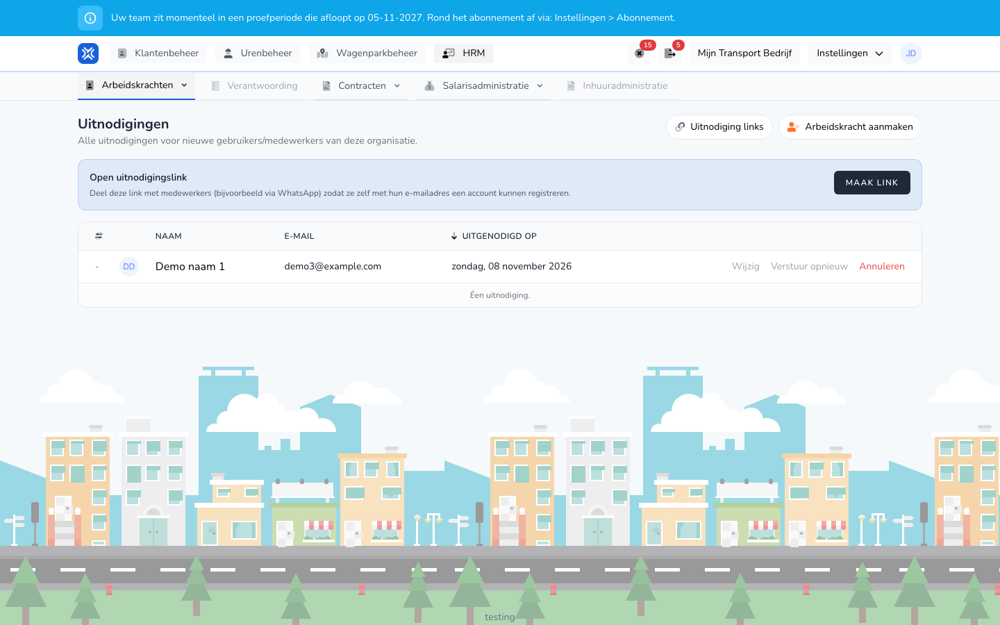

import { Hint } from '/snippets/hint.jsx';

## Waar deze pagina voor is

Hier ziet u wie een uitnodiging heeft gekregen en die nog niet heeft geaccepteerd. U verstuurt een uitnodiging opnieuw, trekt hem in, of maakt een link waarmee mensen zelf een account aanmaken.

## Schermafbeelding

## Wie dit mag gebruiken

- Een beheerder of manager van de organisatie.

## Zo gebruikt u deze pagina

Een uitnodiging versturen:

1. Maak een arbeidskracht aan met **Met gebruikersaccount** en een **E-mail**. Zie [Arbeidskracht aanmaken](/beheerders/personeelszaken/personeel/aanmaken).
2. De uitnodiging gaat meteen naar dat e-mailadres.

Openstaande uitnodigingen:

1. Open **HRM** → **Arbeidskrachten** en klik op **Uitnodigingen**.
2. Klik op **Verstuur opnieuw** om de e-mail nog eens te sturen.
3. Klik op **Annuleren** om een uitnodiging in te trekken, en bevestig met **Verwijder**.
4. Klik op **Wijzig** om de arbeidskracht aan te passen, bijvoorbeeld een verkeerd e-mailadres.

Een open uitnodigingslink:

1. Klik bij **Open uitnodigingslink** op **Maak link**.
2. Klik op **Kopieer** en deel de link, bijvoorbeeld via WhatsApp.
3. Iedereen met de link maakt zelf met het eigen e-mailadres een account aan. <Hint kind="red">Iedereen die de link heeft, kan zich aanmelden bij uw organisatie. Trek een link in als u die niet meer gebruikt.</Hint>
4. Onder **Uitnodiging links** ziet u alle actieve links. Met **Link kopiëren** kopieert u een link opnieuw, met **Intrekken** zet u hem uit.

## Velden

| Kolom | Betekenis |
|-------|-----------|
| **Naam** | De naam van de arbeidskracht. |
| **E-mail** | Het adres waar de uitnodiging naartoe ging. |
| **Uitgenodigd op** | Wanneer de uitnodiging is verstuurd. |

## Wat er daarna gebeurt

- De arbeidskracht krijgt een e-mail met de knop **Uitnodiging accepteren**. Na het accepteren verdwijnt de uitnodiging uit de lijst.
- In het overzicht staat bij een arbeidskracht met een openstaande uitnodiging onder **Acties** ook **Kopier uitnodiging**.

## Beperkingen

- De uitnodiging kan alleen worden geaccepteerd met een account op hetzelfde e-mailadres.
- Een ingetrokken uitnodiging werkt niet meer. Wilt u de arbeidskracht toch uitnodigen, pas dan het e-mailadres aan via **Wijzig**.
