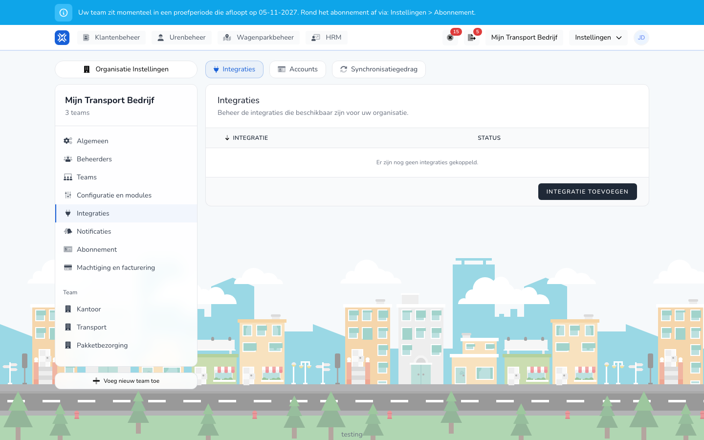

import { Hint } from '/snippets/hint.jsx';

## Waar deze pagina voor is

Met een salariskoppeling verbindt u TransportKlok met uw salarispakket: Nmbrs, Loket.nl, AFAS Profit of Exact Online. Hier leest u hoe u een koppeling maakt, hoe u salarisrondes verstuurt en waar u ziet of dat is gelukt.

## Schermafbeelding

## Wie dit mag gebruiken

- Een beheerder of manager van de organisatie.
- De organisatie heeft de module **Salarismutaties** nodig. <Hint kind="grey">De salariskoppelingen zijn in bèta. U ziet ze alleen als uw organisatie meedoet aan het bètaprogramma.</Hint>

## Zo gebruikt u deze pagina

Een koppeling maken gaat in twee stappen: eerst een account bij uw salarispakket, dan de koppeling zelf.

Het account:

1. Open **Instellingen** → **Organisatie Instellingen** → **Integraties**.
2. Open het tabblad **Accounts** en klik op **Account aanmaken**.
3. Kies bij **Integratie** uw salarispakket en vul een **Naam** in.
4. Klik op **Account aanmaken**. U gaat naar de inlogpagina van uw salarispakket.
5. Log daar in en geef toestemming.
6. U komt terug op **Accounts**. Het account staat op **Verbonden**.

De koppeling:

1. Open het tabblad **Integraties** en klik op **Integratie toevoegen**.
2. Klik bij uw salarispakket op **Verbinden**.
3. Kies het **Account** dat u net hebt gemaakt.
4. Vul de overige velden in, zoals de **Werkgever** bij Nmbrs, en geef de koppeling een **Naam**.
5. Klik op **Verbinden**.
6. Vul op de pagina met instellingen in wat uw salarispakket nodig heeft en klik op **Instellingen opslaan**.

Salarisrondes laten versturen:

1. Open het tabblad **Synchronisatiegedrag**.
2. Zet bij **Salarisrondes versturen** de schakelaar aan voor uw koppeling.
3. Klik op **Instellingen opslaan**.

## Velden

| Veld | Wat u invult |
|------|--------------|
| **Integratie** | Het salarispakket. |
| **Naam** (account) | Een naam waaraan u het account herkent. |
| **Account** | Het account waarmee de koppeling inlogt bij uw salarispakket. |
| **Naam** (koppeling) | De naam in het overzicht, bijvoorbeeld de naam van uw bv. |

## Wat er daarna gebeurt

- De koppeling staat in het overzicht op **Verbonden**.
- Staat **Salarisrondes versturen** aan, dan heet de knop bij een salarisronde **Versturen** in plaats van **Afronden**. Met **Versturen** wordt de ronde verwerkt en naar uw salarispakket gestuurd. Zie [Salarisronde verwerken](/beheerders/personeelszaken/salarisrondes/verwerken).
- Op **Synchronisatiegedrag** opent **Uitvoeringen** de lijst van verzendingen, met per keer het begin, de status en de duur. Een verzending staat op **Wacht**, **Bezig**, **Geslaagd**, **Mislukt** of **Overgeslagen**.
- Ontbreken er rechten of instellingen, dan ziet u een melding met **Opnieuw autoriseren** of **Instellingen openen**.

## Beperkingen

- Een koppeling loskoppelen doet u bij **Integraties** met **Loskoppelen**. Vink **Ook het onderliggende OAuth-account loskoppelen.** aan om ook het account te verwijderen.
- **Account loskoppelen** op het tabblad **Accounts** verwijdert ook alle koppelingen die dat account gebruiken. <Hint kind="red">Een losgekoppelde koppeling verstuurt niets meer. Om weer te versturen maakt u de koppeling opnieuw.</Hint>
- Wat er per salarispakket wordt verstuurd en opgehaald, staat op de pagina van dat pakket: [Nmbrs](/beheerders/personeelszaken/salariskoppelingen/nmbrs), [Loket.nl](/beheerders/personeelszaken/salariskoppelingen/loket), [AFAS Profit](/beheerders/personeelszaken/salariskoppelingen/afas) en [Exact Online](/beheerders/personeelszaken/salariskoppelingen/exact-online).
