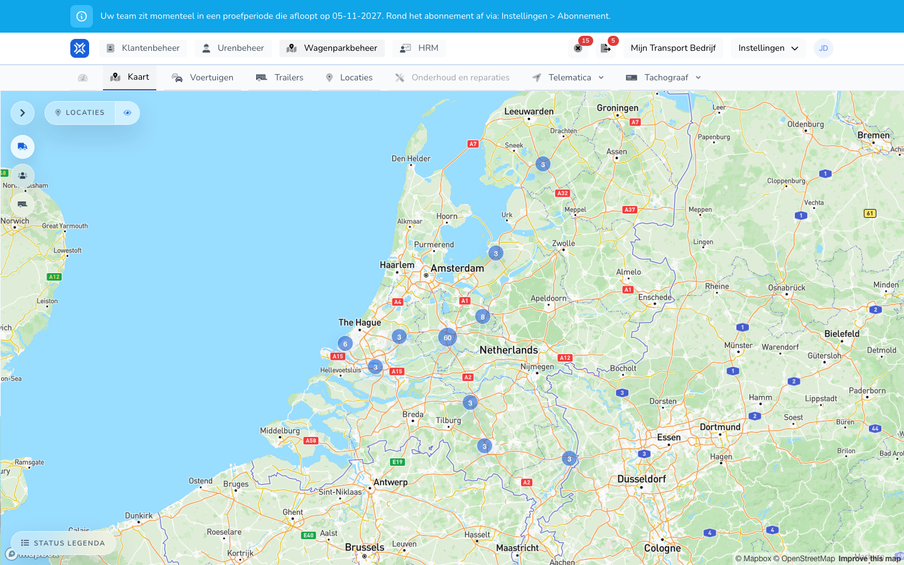

import { Hint } from '/snippets/hint.jsx';

## Waar deze pagina voor is

Op de kaart ziet u waar uw voertuigen, personen en trailers nu zijn en of ze rijden. Per voertuig bekijkt u ook de route, ritten en gebeurtenissen.

## Schermafbeelding

## Wie dit mag gebruiken

- Een beheerder met volledige rechten in de organisatie.
- De organisatie heeft de module **Wagenparkbeheer** nodig, en telematica moet aan staan.

## Zo gebruikt u deze pagina

1. Open **Wagenparkbeheer** en kies **Kaart**.
2. Klik op de pijl links bovenaan om de lijst te openen. Kies daar voertuigen, personen of trailers.
3. Zoek in de lijst op kenteken, merk of adres. Voertuigen die rijden staan bovenaan.
4. Klik op een voertuig om het op de kaart te volgen en de details te openen.
5. Kies onderaan een route, zoals **Route van vandaag** of **Route van afgelopen 7 dagen**.
6. Met **Locaties** zet u uw locaties aan of uit op de kaart.
7. Met **Status legenda** ziet u wat de kleuren betekenen.

## Velden

De status van een voertuig:

| Status | Betekenis |
|--------|-----------|
| **Rijdend** | Het voertuig is in beweging. |
| **Motor aan, net gestopt** | Het contact staat aan en de laatste beweging was recent. |
| **Recent geparkeerd** | Het contact staat uit en het voertuig is net gestopt. |
| **Motor aan, stationair** | Het contact staat aan, maar het voertuig staat al langer stil. |
| **Geparkeerd** | Het contact staat uit en het voertuig staat al een tijd stil. |
| **Status onbekend** | Er is nog geen betrouwbare live status. |

Bij een voertuig ziet u onderaan de tabbladen **Locatiepunten**, **Grafiek**, **Activiteiten**, **Gebeurtenissen** en **Ritten**. <Hint kind="yellow">Welke gegevens er zijn, zoals brandstof, rijgedrag en kilometerstand, hangt af van de tracker of het telematicasysteem van het voertuig.</Hint>

## Wat er daarna gebeurt

- De kaart ververst de posities vanzelf, ongeveer elke paar seconden.
- Posities komen van de trackers van TransportKlok en van uw [GPS-koppelingen](/beheerders/wagenparkbeheer/koppelingen/overzicht). Op de kaart ziet u geen verschil tussen die bronnen.
- Bij een rit kunt u met **Wijzig modus** kiezen of die **Zakelijk** of **Privé** is.

## Beperkingen

- Een voertuig zonder positie staat niet op de kaart. Heeft een voertuig nog geen gegevens, dan ziet u "Er zijn nog geen items gedetecteerd met een tracker."
- Is de verbinding met de live gegevens even weg, dan ziet u **Fleet Connect is tijdelijk niet beschikbaar**. <Hint kind="grey">De kaart probeert het elke 15 seconden opnieuw. U hoeft niets te doen.</Hint>
- Voor het aanpassen van voertuiggegevens gebruikt u [Voertuigen](/beheerders/wagenparkbeheer/voertuigen/overzicht).
