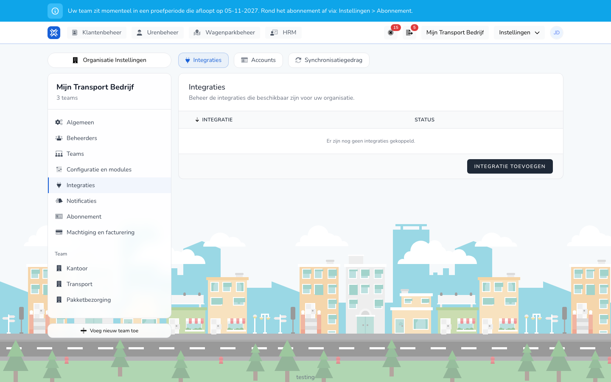

import { Hint } from '/snippets/hint.jsx';

## Waar deze pagina voor is

Met een GPS-koppeling haalt TransportKlok gegevens op uit uw telematicasysteem: voertuigen, bestuurders, wie in welk voertuig rijdt, en de posities van de voertuigen. U kunt koppelen met Webfleet, Samsara, Geotab, FleetGo, Linqo, CO3 en Verizon Connect.

## Schermafbeelding

## Wie dit mag gebruiken

- Een beheerder of manager van de organisatie.
- De organisatie heeft de module **Wagenparkbeheer** nodig, en telematica moet aan staan. <Hint kind="yellow">Staat telematica niet aan voor uw organisatie, dan ziet u bij het koppelen: "Telematica is niet ingeschakeld voor deze organisatie. Schakel eerst telematica in voordat je een koppeling maakt."</Hint>
- De GPS-koppelingen zijn in bèta. <Hint kind="grey">U ziet ze alleen als uw organisatie meedoet aan het bètaprogramma.</Hint>

## Zo gebruikt u deze pagina

Het account:

1. Open **Instellingen** → **Organisatie Instellingen** → **Integraties**.
2. Open het tabblad **Accounts** en klik op **Account aanmaken**.
3. Kies bij **Integratie** uw systeem en vul een **Naam** in.
4. Vul de inloggegevens in die het systeem vraagt, zoals een **Token** of een **Gebruikersnaam** en **Wachtwoord**.
5. Klik op **Account aanmaken**. Het account staat daarna op **Verbonden**.

De koppeling:

1. Open het tabblad **Integraties** en klik op **Integratie toevoegen**.
2. Klik bij uw systeem op **Verbinden**.
3. Kies het **Account**, geef de koppeling een **Naam** en klik op **Verbinden**.
4. Vul de instellingen in en klik op **Instellingen opslaan**.

## Velden

De inloggegevens en instellingen verschillen per systeem. Zie de pagina van uw systeem:

| Systeem | Inloggen met |
|---------|--------------|
| [Webfleet](/beheerders/wagenparkbeheer/koppelingen/webfleet) | **Gebruikersnaam** en **Wachtwoord** |
| [Samsara](/beheerders/wagenparkbeheer/koppelingen/samsara) | **Token** |
| [Geotab](/beheerders/wagenparkbeheer/koppelingen/geotab) | **Token** |
| [FleetGo](/beheerders/wagenparkbeheer/koppelingen/fleetgo) | **Gebruikersnaam** en **Wachtwoord** |
| [Linqo](/beheerders/wagenparkbeheer/koppelingen/linqo) | **Token** |
| [CO3](/beheerders/wagenparkbeheer/koppelingen/co3) | **Client-ID** en **Client secret** |
| [Verizon Connect](/beheerders/wagenparkbeheer/koppelingen/verizon-connect) | **Gebruikersnaam** en **Wachtwoord** |

## Wat er daarna gebeurt

Op het tabblad **Synchronisatiegedrag** staat per functie welke koppeling gegevens ophaalt:

| Functie | Wat het doet |
|---------|--------------|
| **Voertuigen synchroniseren** | Haalt voertuigen op en koppelt ze aan uw voertuigen in TransportKlok. |
| **Bestuurders synchroniseren** | Vult bij medewerkers de tachograafkaartcode aan. |
| **Voertuigtoewijzingen synchroniseren** | Haalt op welke bestuurder in welk voertuig rijdt. |
| **Telemetrie ontvangen** | Haalt posities en andere voertuiggegevens op. Die ziet u op de [Kaart](/beheerders/wagenparkbeheer/kaart). |

- Elke functie loopt vanzelf op vaste tijden. Met **Synchroniseren** start u een functie meteen.
- Met de schakelaar zet u een functie aan of uit. <Hint kind="grey">Sommige functies zijn verplicht voor een koppeling en kunt u niet uitzetten.</Hint>
- **Uitvoeringen** toont per keer het begin, de status (**Geslaagd**, **Mislukt** of **Overgeslagen**), de duur en het aantal logregels.

## Beperkingen

- Een voertuig krijgt zijn posities uit één bron. Komt een voertuig al uit een andere bron, dan slaat de koppeling het over.
- De koppelingen halen alleen gegevens op. Ze sturen niets terug naar uw telematicasysteem.
- Loskoppelen werkt zoals bij de [salariskoppelingen](/beheerders/personeelszaken/salariskoppelingen/overzicht): **Loskoppelen** bij **Integraties**, of **Account loskoppelen** bij **Accounts**. <Hint kind="red">Na loskoppelen worden er geen voertuigen en posities meer opgehaald.</Hint>
