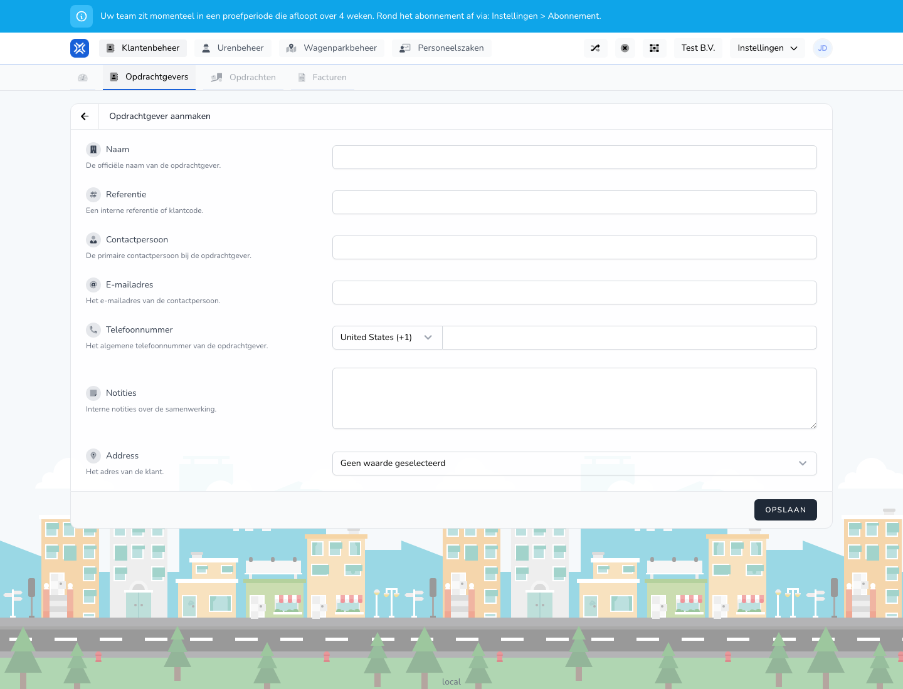

{/* translated-from: nl/management/customer-management/customers/edit.mdx sha256:71c8ffe062178869381f77ad24b55679c91e0a6a3a5152079a1b450b9033666f */}

## Wofür diese Seite da ist

Mit dieser Seite passen Sie die Daten eines bestehenden Auftraggebers an. Die Felder ähneln denen der Seite zum Anlegen.

## Was Sie hier tun können

- Name, Referenz und Kontaktdaten aktualisieren.

## Screenshot

## Was Sie auf der Seite sehen

- Ein Formular mit denselben Hauptfeldern wie beim Anlegen.

## So nutzen Sie diese Seite

1. Öffnen Sie einen bestehenden Auftraggeber aus der Übersicht.
2. Passen Sie die Daten an, die sich geändert haben.
3. Prüfen Sie die Kontaktdaten noch einmal.
4. Speichern Sie die Änderungen.

## Was danach passiert

- Die geänderten Daten werden in der Übersicht und in verknüpften Abläufen verwendet.

## Wichtig zu wissen

- Nutzen Sie in der Praxis die Übersicht als Ausgangspunkt, um einen echten Auftraggeber zu öffnen.

## Verwandte Seiten

- Übersicht der Auftraggeber
- Auftraggeber anlegen

