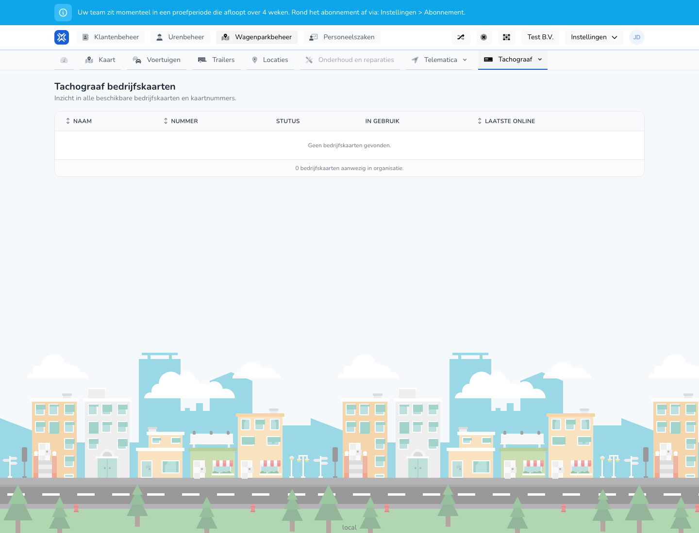

{/* translated-from: nl/management/fleet-management/tachograph/company-cards.mdx sha256:dd4c7035f0c017cdbf973b477f3d4685be97f592cc20e04f0eaa8f2f7d9182ed */}

## Wofür diese Seite da ist

Hier sehen Sie, welche Unternehmenskarten verfügbar sind und ob sie verwendet werden.

## Was Sie hier tun können

- Unternehmenskarten prüfen.
- Kartennummern und Status ansehen.

## Screenshot

## Was Sie auf der Seite sehen

- Eine Tabelle mit Name, Nummer, Status, in Verwendung und zuletzt online.

## So nutzen Sie diese Seite

1. Öffnen Sie **Fahrtenschreiber-Unternehmenskarten**.
2. Prüfen Sie, welche Karten verfügbar sind.
3. Beurteilen Sie anhand von Status und zuletzt online, ob eine Karte noch aktiv verwendet wird.

## Was danach passiert

- Sie haben schnell einen Überblick über den Kartenbestand und den Kartenstatus.

## Wichtig zu wissen

- Nutzen Sie diesen Bildschirm vor allem zur Übersicht und Kontrolle.

## Verwandte Seiten

- Fahrzeuge mit Fahrtenschreiber
- Fahrer mit Fahrerkarte

