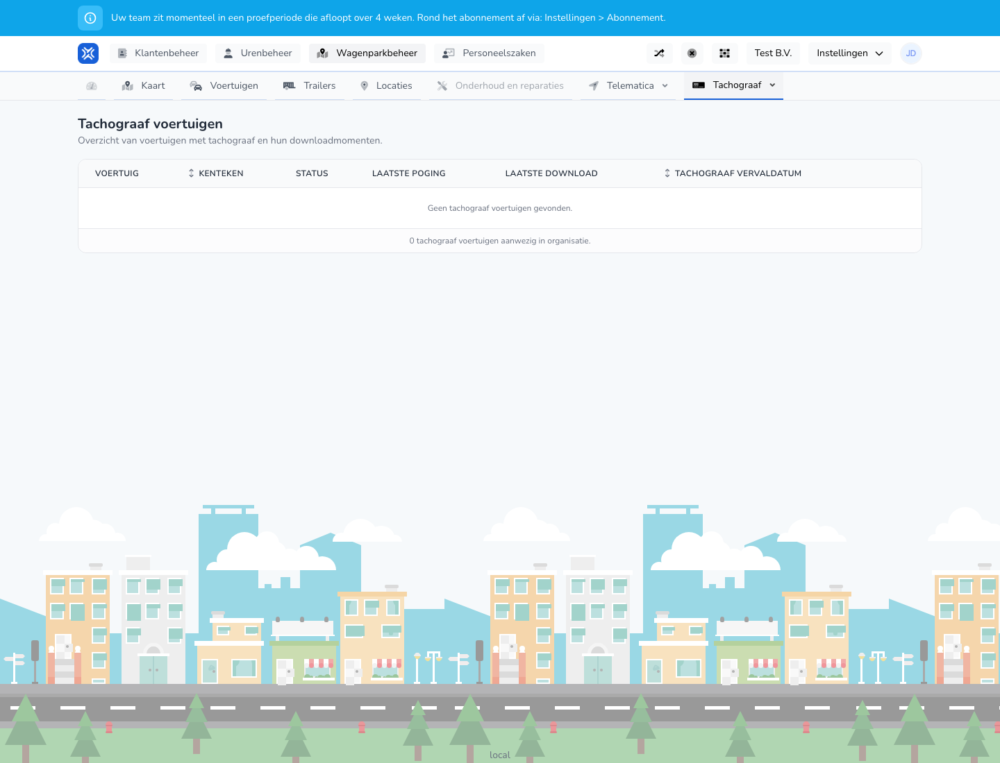

{/* translated-from: nl/management/fleet-management/tachograph/vehicles.mdx sha256:1abe3a22ad07449ebcc46e1b125a41a709dd2d4e378b4ab8aa5ea7e091ea6616 */}

## Wofür diese Seite da ist

Hier sehen Sie für Fahrzeuge mit Fahrtenschreiber-Informationen, wann ein Download versucht wurde oder gelungen ist.

## Was Sie hier tun können

- Prüfen, welche Fahrzeuge Fahrtenschreiber-Daten haben.
- Download-Zeitpunkte und Status ansehen.

## Screenshot

## Was Sie auf der Seite sehen

- Eine Tabelle mit Fahrzeug, Kennzeichen, Status, letztem Versuch, letztem Download und Ablaufdatum.

## So nutzen Sie diese Seite

1. Öffnen Sie **Fahrzeuge mit Fahrtenschreiber**.
2. Prüfen Sie die Statusspalte.
3. Sehen Sie sich danach den letzten Versuch und den letzten Download an, um festzustellen, ob die Daten kürzlich aktualisiert wurden.

## Was danach passiert

- Sie wissen, welche Fahrzeuge bei den Fahrtenschreiber-Downloads noch Aufmerksamkeit benötigen.

## Wichtig zu wissen

- Leere oder alte Download-Zeitpunkte erfordern oft eine zusätzliche Kontrolle.

## Verwandte Seiten

- Fahrer mit Fahrerkarte
- Fahrtenschreiber-Unternehmenskarten

