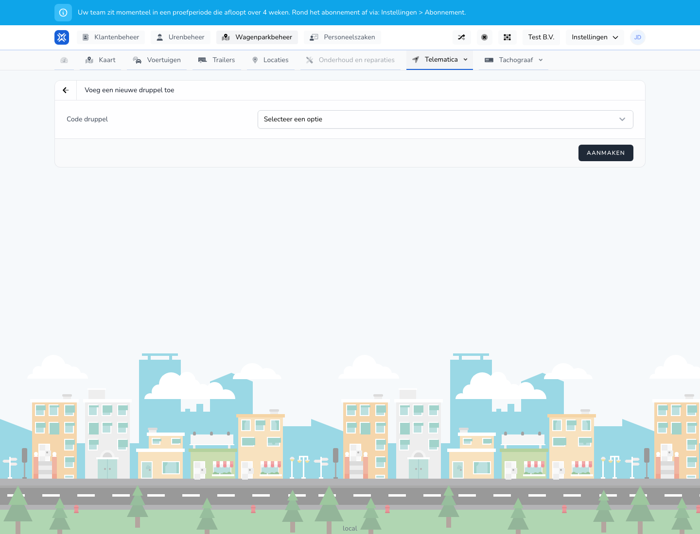

{/* translated-from: nl/management/fleet-management/telematics/beacons/create.mdx sha256:db3135f9769b74c2c1cdf48e3f0b1dfac635fe2ca0ea113590d533ad618c90b2 */}

## Wofür diese Seite da ist

Mit diesem Formular fügen Sie einen neuen Beacon hinzu.

## Was Sie hier tun können

- Den Beacon-Code wählen oder eintragen.
- Den Beacon speichern.

## Screenshot

## Was Sie auf der Seite sehen

- Den Bildschirm **Fügen Sie einen neuen Beacon hinzu**.
- Ein Feld für den Beacon-Code.
- Die Schaltfläche **Erstellen**.

## So nutzen Sie diese Seite

1. Öffnen Sie **Beacon hinzufügen**.
2. Geben Sie den richtigen Code ein oder wählen Sie ihn aus.
3. Klicken Sie auf **Erstellen**.

## Was danach passiert

- Der Beacon erscheint in der Übersicht.
- Danach können Sie den Beacon mit einem Mitarbeitenden oder Anhänger verknüpfen.

## Wichtig zu wissen

- Verwenden Sie den richtigen Code, um doppelte oder falsche Verknüpfungen zu vermeiden.

## Verwandte Seiten

- Übersicht der Beacons
- Beacon verknüpfen

