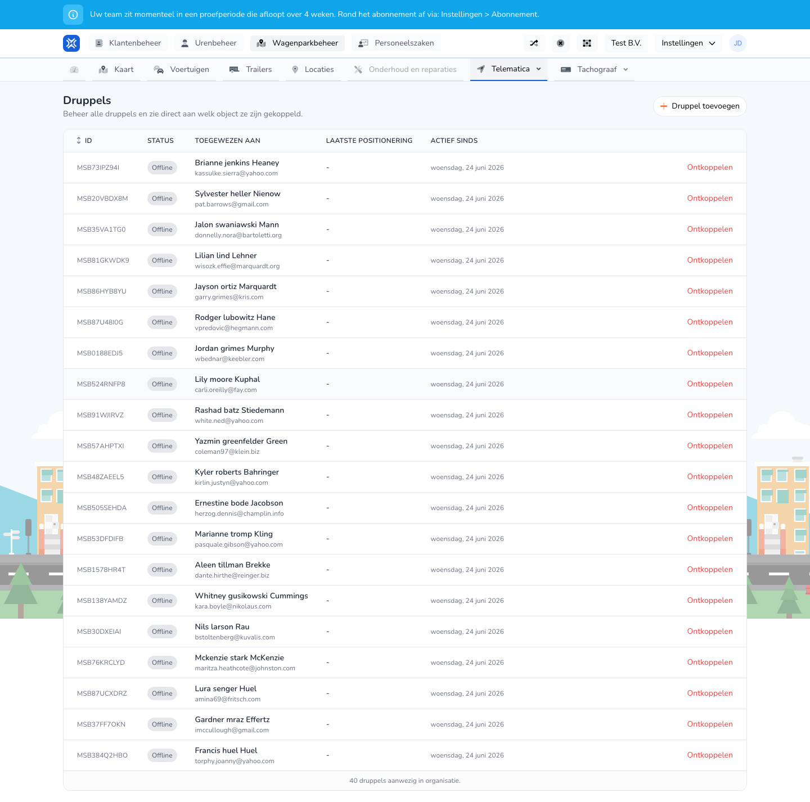

{/* translated-from: nl/management/fleet-management/telematics/beacons/overview.mdx sha256:4f366e4b6e5a6d78326b3d97ec01fa3524a40979aa74b911d82a8a3fa4a5109d */}

## Wofür diese Seite da ist

Hier sehen Sie alle Beacons, ihren Status und mit welchem Objekt sie verknüpft sind.

## Was Sie hier tun können

- Beacons ansehen.
- Einen Beacon hinzufügen.
- Prüfen, ob ein Beacon bereits verknüpft ist.

## Screenshot

## Was Sie auf der Seite sehen

- Die Schaltfläche **Beacon hinzufügen**.
- Eine Tabelle mit ID, Status, zugewiesen an, letzter Positionierung und aktiv seit.

## So nutzen Sie diese Seite

1. Öffnen Sie **Beacons**.
2. Suchen Sie den richtigen Beacon in der Tabelle.
3. Prüfen Sie, ob der Beacon bereits verknüpft ist.
4. Fügen Sie einen neuen Beacon hinzu, wenn er noch fehlt.

## Was danach passiert

- Sie sehen, welche Beacons noch Aufmerksamkeit benötigen.

## Wichtig zu wissen

- Nicht verknüpfte oder offline befindliche Beacons fallen hier sofort auf.

## Verwandte Seiten

- Beacon hinzufügen
- Beacon verknüpfen

