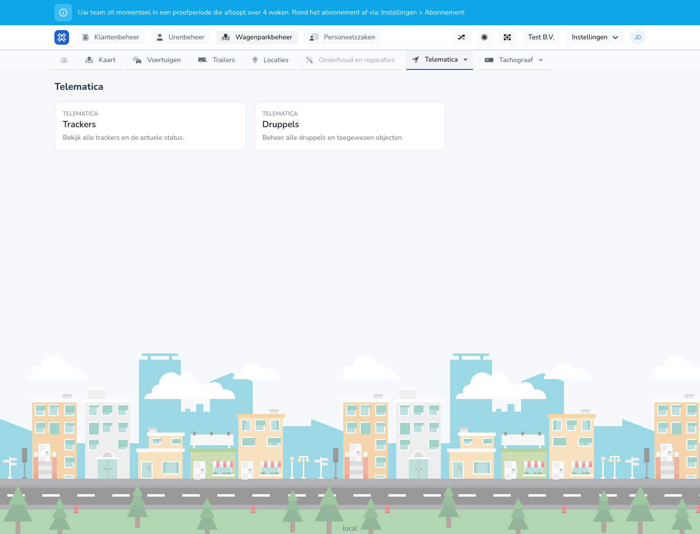

{/* translated-from: nl/management/fleet-management/telematics/overview.mdx sha256:40c0fe7135e6fd87d57b6f3b53e74856ba764381f6d6f00be80f5868d7a79263 */}

## Wofür diese Seite da ist

Auf dieser Seite wählen Sie, ob Sie mit Trackern oder mit Beacons weiterarbeiten möchten.

## Was Sie hier tun können

- Zur Tracker-Übersicht gehen.
- Zur Beacon-Übersicht gehen.

## Screenshot

## Was Sie auf der Seite sehen

- Zwei deutliche Kacheln oder Blöcke: **Tracker** und **Beacons**.
- Eine kurze Erläuterung zu jedem Bereich.

## So nutzen Sie diese Seite

1. Öffnen Sie **Telematik**.
2. Wählen Sie **Tracker**, wenn Sie Fahrzeug-Tracker verwalten möchten.
3. Wählen Sie **Beacons**, wenn Sie Beacons verwalten oder verknüpfen möchten.

## Was danach passiert

- Sie gelangen zum gewählten Telematik-Bereich.

## Wichtig zu wissen

- Nutzen Sie diesen Bildschirm als Ausgangspunkt innerhalb der Telematik.
- Die eigentlichen Verwaltungsaktionen finden Sie auf den Folgebildschirmen.

## Verwandte Seiten

- Übersicht der Tracker
- Übersicht der Beacons

