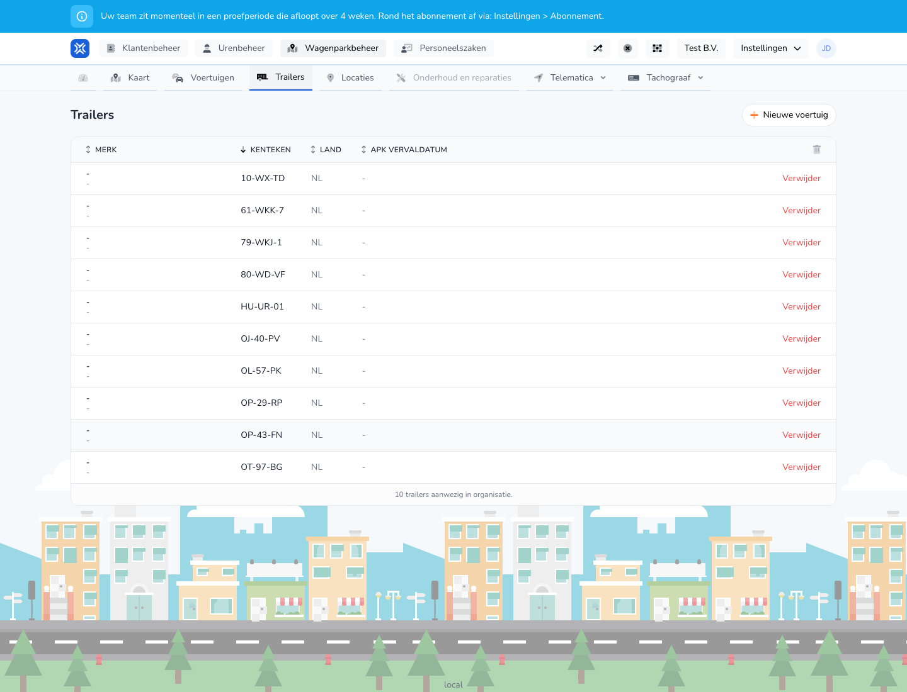

{/* translated-from: nl/management/fleet-management/trailers/overview.mdx sha256:ce82b614f18ebe1bd1aeb1ee77966fa4d51f68900fc4d6bd9b852e88794c8574 */}

## Wofür diese Seite da ist

Hier verwalten Sie alle Anhänger. Sie sehen sofort, welche Anhänger bekannt sind und welche Aktionen verfügbar sind.

## Was Sie hier tun können

- Anhänger ansehen.
- Einen Anhänger hinzufügen.
- Einen Anhänger löschen.

## Screenshot

## Was Sie auf der Seite sehen

- Die Schaltfläche **Neues Fahrzeug** für die Erfassung eines neuen Anhängers.
- Eine Tabelle mit Kennzeichen, Land und Ablaufdatum der Hauptuntersuchung.
- Aktionen pro Anhängerzeile.

## So nutzen Sie diese Seite

1. Öffnen Sie **Anhänger** in der Fuhrparkverwaltung.
2. Suchen Sie den richtigen Anhänger in der Tabelle.
3. Öffnen Sie die Seite zum Anlegen, wenn Sie einen neuen Anhänger erfassen möchten.
4. Nutzen Sie die pro Zeile verfügbaren Aktionen für die weitere Bearbeitung.

## Was danach passiert

- Neue Anhänger erscheinen in der Übersicht.
- Gelöschte Anhänger verschwinden aus der aktiven Liste.

## Wichtig zu wissen

- Achten Sie besonders auf Kennzeichen und Ablaufdatum.
- In dieser Übersicht sehen Sie schnell, ob die Anhängerdaten noch vollständig sind.

## Verwandte Seiten

- Anhänger erstellen
- Anhänger bearbeiten

