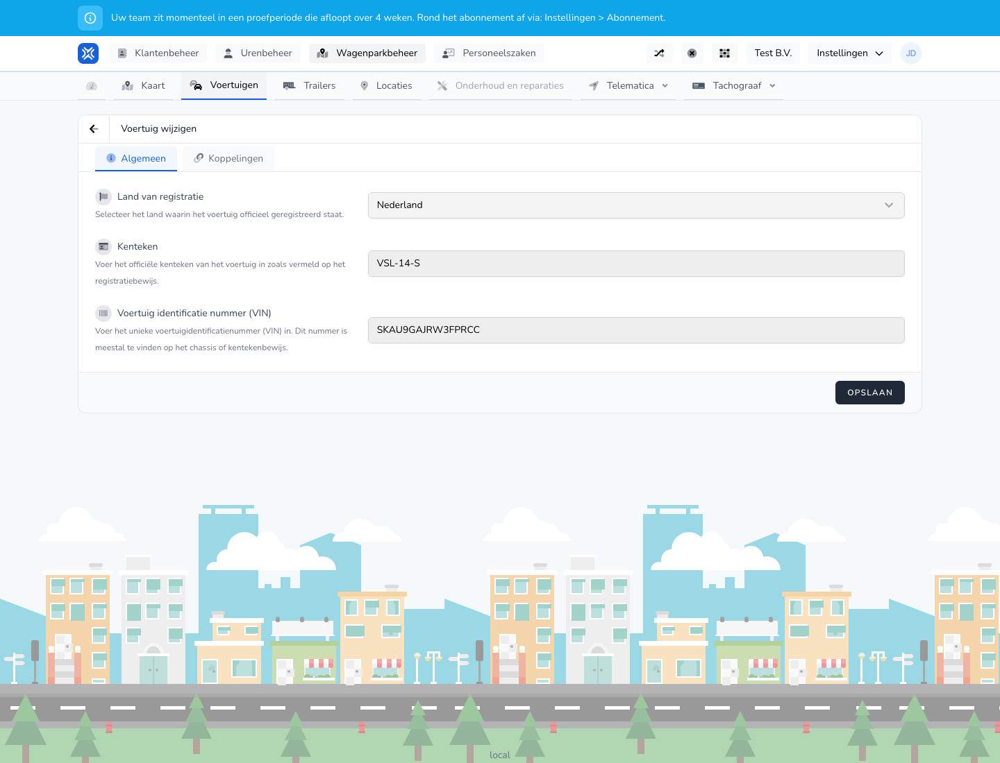

{/* translated-from: nl/management/fleet-management/vehicles/edit.mdx sha256:85343e130739b1c079b1d0d7b1d7c7ba84cb20d6aac85476dff698f5fe7beccf */}

## Wofür diese Seite da ist

Mit dieser Seite passen Sie die Daten eines bestehenden Fahrzeugs an.

## Was Sie hier tun können

- Zulassungs- und Fahrzeugdaten ändern.
- Kontrollpunkte und Verknüpfungen durchgehen.

## Screenshot

## Was Sie auf der Seite sehen

- Den Bildschirm **Fahrzeug bearbeiten**.
- Dieselben Hauptabschnitte wie beim Anlegen, etwa **Allgemein** und **Zuweisungen**.
- Bereits ausgefüllte Fahrzeugdaten.

## So nutzen Sie diese Seite

1. Öffnen Sie das Fahrzeug über **Bearbeiten** in der Übersicht.
2. Ändern Sie nur die Felder, die sich ändern müssen.
3. Prüfen Sie nach einer Änderung immer Kennzeichen, Land und weitere Identifikationsdaten.
4. Speichern Sie die Änderungen.

## Was danach passiert

- Die angepassten Daten werden in der Fahrzeugübersicht sichtbar.
- Andere Bildschirme, die dieses Fahrzeug verwenden, zeigen danach die neuen Informationen.

## Wichtig zu wissen

- Arbeiten Sie sorgfältig, da Fahrzeugdaten an mehreren Stellen wieder auftauchen können.
- Prüfen Sie nach dem Speichern, ob die Änderung in der Übersicht richtig verarbeitet wurde.

## Verwandte Seiten

- Übersicht der Fahrzeuge
- Fahrzeug anlegen

