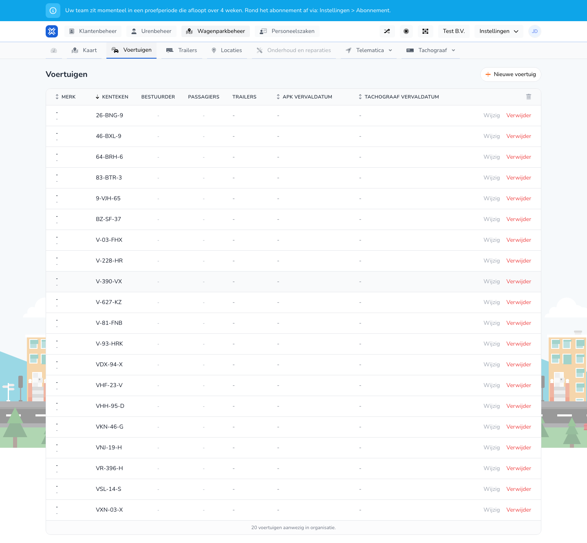

{/* translated-from: nl/management/fleet-management/vehicles/overview.mdx sha256:df0b53871e7802ca7b569d316db71b20ff80ac2dc8585ca85636d24d0f67fc0b */}

## Wofür diese Seite da ist

Hier verwalten Sie die Fahrzeuge Ihrer Organisation. Pro Fahrzeug sehen Sie die wichtigsten Daten und die verfügbaren Aktionen.

## Was Sie hier tun können

- Fahrzeuge ansehen.
- Ein neues Fahrzeug anlegen.
- Ein bestehendes Fahrzeug ändern oder löschen.

## Screenshot

## Was Sie auf der Seite sehen

- Die Schaltfläche **Neues Fahrzeug**.
- Eine Tabelle mit Spalten wie Marke, Kennzeichen, Fahrer, Beifahrer und Ablaufdaten.
- Aktionen wie **Bearbeiten** und **Löschen** pro Zeile.

## So nutzen Sie diese Seite

1. Öffnen Sie **Fahrzeuge** in der Fuhrparkverwaltung.
2. Suchen Sie das richtige Fahrzeug in der Tabelle.
3. Klicken Sie auf **Bearbeiten**, wenn Sie Daten anpassen möchten.
4. Klicken Sie auf **Neues Fahrzeug**, wenn Sie ein weiteres Fahrzeug erfassen möchten.
5. Verwenden Sie **Löschen** nur, wenn das Fahrzeug nicht mehr aktiv genutzt wird.

## Was danach passiert

- Nach dem Öffnen von **Bearbeiten** gelangen Sie in das Bearbeitungsformular dieses Fahrzeugs.
- Nach **Neues Fahrzeug** öffnet sich das Formular zur Eingabe der Fahrzeugdaten.
- Nach dem Löschen verschwindet das Fahrzeug aus der aktiven Übersicht.

## Wichtig zu wissen

- Prüfen Sie Kennzeichen und Ablaufdaten sorgfältig, bevor Sie speichern.
- Nutzen Sie diese Übersicht als Ausgangspunkt für fast alle Fahrzeugverwaltungsaktionen.

## Verwandte Seiten

- Fahrzeug anlegen
- Fahrzeug bearbeiten
- Karte

