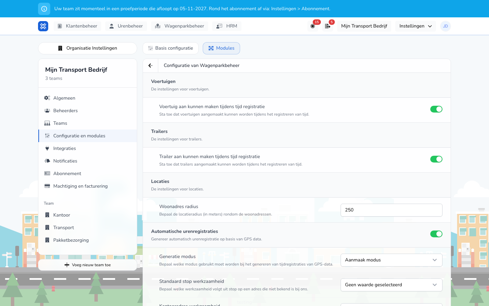

{/* translated-from: nl/management/hour-management/automatic-time-registrations.mdx sha256:8b44d3f0a9616d4758e17dc8431e6c1ec2dadce4e01ed4209ea540241fd87ef9 */}

import { Hint } from '/snippets/hint.jsx';

## Wofür diese Seite da ist

Mit der automatischen Stundenerfassung erstellt TransportKlok Zeiteinträge aus den Fahrten und Stopps, die Ihre GPS-Integration oder Ihre Tracker übermitteln. Ihre Mitarbeitenden müssen diese Stunden dann nicht selbst erfassen.

## Screenshot

## Wer das nutzen darf

- Ein Administrator der Organisation schaltet sie ein.
- Die Organisation benötigt die Module **Fuhrparkverwaltung** und **Stundenverwaltung** sowie Fahrzeuge mit einem Tracker oder einer GPS-Integration. Siehe [Telematik](/de/management/fleet-management/telematics/overview).

## So nutzen Sie diese Seite

1. Öffnen Sie **Einstellungen** → **Organisationseinstellungen** → **Konfiguration und Module** und wählen Sie den Tab **Module**.
2. Klicken Sie bei **Fuhrparkverwaltung** auf **Einstellungen**.
3. Schalten Sie **Automatische Zeiteinträge** ein.
4. Wählen Sie den **Erzeugungsmodus** und die Tätigkeiten je Adressart.
5. Klicken Sie auf **Speichern**.

## Felder

| Feld | Was Sie wählen |
|------|-------------|
| **Erzeugungsmodus** | **Erstellungsmodus**: TransportKlok erstellt neue Zeiteinträge aus den GPS-Daten. **Ersetzungsmodus**: TransportKlok erstellt keine neuen Einträge, sondern ergänzt in bestehenden Einträgen die Tätigkeit **Automatisch (GPS-Segment)** mit den Fahrten und Stopps. Standardmäßig ist der **Erstellungsmodus** eingeschaltet. |
| **Standardtätigkeit bei Stopp** | Die Tätigkeit für einen Stopp an einer Adresse, die TransportKlok nicht kennt. Standardmäßig leer: Ein solcher Stopp erhält dann keine Tätigkeit. |
| **Tätigkeit bei Büroadresse** | Die Tätigkeit für einen Stopp an einer Büroadresse. Standardmäßig **Depot**. |
| **Tätigkeit bei Wohnadresse** | Die Tätigkeit für einen Stopp an einer Wohnadresse. Standardmäßig **Depot**. |
| **Tätigkeit bei Kundenadresse** | Die Tätigkeit für einen Stopp an einer Kundenadresse. Standardmäßig **Laden & Entladen (extern)**. |
| **Stopplänge (Minuten)** | Wie lange ein Stopp dauern muss, um die Fahrt davor abzuschließen. Standardmäßig 240 Minuten. |
| **Minimale Aktivitätsdauer (Sekunden)** | Wie lange eine Aktivität dauern muss, um eine Zeile im Eintrag zu werden. Standardmäßig 60 Sekunden. |
| **Automatische Registrierungen beginnen am** | Das Datum, ab dem TransportKlok Einträge erstellt. Leer: ohne festes Startdatum. |
| **Kein festes Startdatum** | Ein: Der Mitarbeitende hat kein festes Startdatum, unabhängig vom Datum der Organisation. |
| **Unbezahlter Arbeitsweg** | Ein: Fahrten zwischen Zuhause und Büro werden auf die unbezahlte Tätigkeit für den Arbeitsweg gebucht. |

Welche Art von Adresse ein Stopp ist, ergibt sich aus Ihren [Standorten](/de/management/fleet-management/locations/overview).

## Was danach passiert

- Aus den Fahrten und Stopps eines Mitarbeitenden erstellt TransportKlok einen Zeiteintrag, mit den Fahrten und Stopps als Tätigkeiten.
- Die Einträge stehen unter [Zeiterfassung](/de/management/hour-management/time-registrations/overview) und in der App des Mitarbeitenden, wie jeder andere Eintrag. Sie genehmigen sie auf dieselbe Weise.
- Einen Eintrag, der genehmigt wurde, den jemand angepasst hat oder der in einen verarbeiteten Abrechnungszeitraum fällt, passt TransportKlok nicht mehr an.

TransportKlok arbeitet mit zwei Versionen der automatischen Stundenerfassung. <Hint kind="grey">Welche Version Ihre Organisation verwendet, stellt TransportKlok für Sie ein. Die obigen Einstellungen sind für beide Versionen gleich.</Hint>

| Version | So funktioniert es |
|--------|---------------|
| Version 1 | TransportKlok erstellt die Einträge in einem Durchgang aus den Fahrten und Stopps. Überschneidet sich eine Fahrt mit einem bestehenden Eintrag, überspringt es diese Fahrt. |
| Version 2 | TransportKlok aktualisiert die Einträge, sobald neue GPS-Daten eingehen, und lässt genehmigte oder angepasste Einträge unberührt. |

## Einschränkungen

- Die automatische Stundenerfassung funktioniert für eine Organisation mit genau einem Team. Hat Ihre Organisation mehr Teams, sehen Sie beim Einschalten „Automatische Stundenerfassung erfordert eine Organisation mit genau einem Team".
- Ein Mitarbeitender muss in TransportKlok mit dem Fahrzeug und den GPS-Daten verknüpft sein. Ohne diese Verknüpfung entstehen keine Einträge.
- Passt ein Eintrag nicht, zum Beispiel weil er sich mit einem bestehenden Eintrag überschneidet oder außerhalb des Vertrags liegt, erstellt TransportKlok diesen Eintrag nicht. <Hint kind="yellow">Prüfen Sie dann die Einträge dieses Tages selbst unter Zeiterfassung.</Hint>
