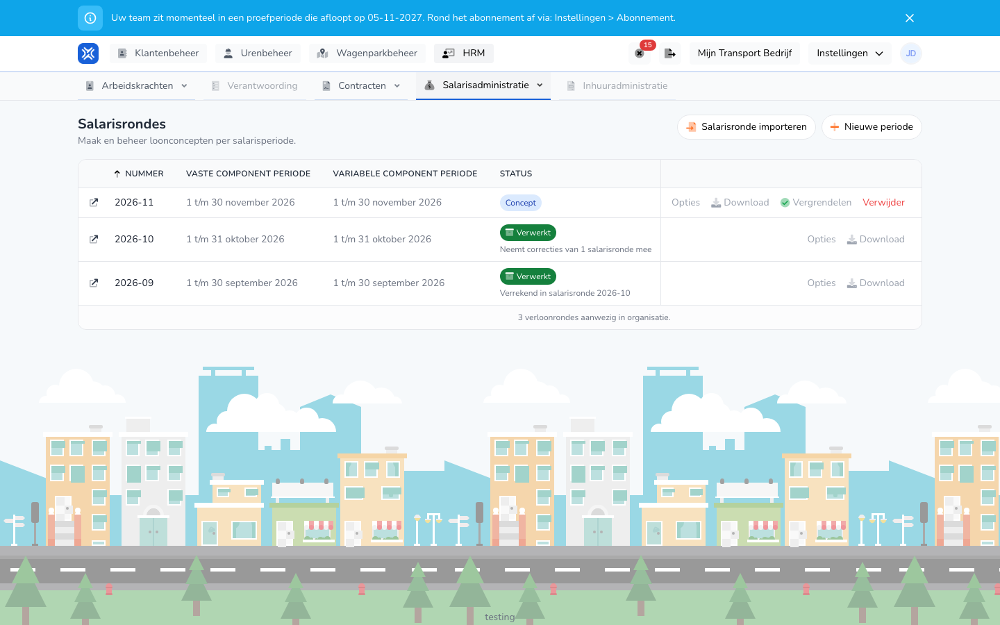

{/* translated-from: nl/management/human-resources/payroll-runs/overview.mdx sha256:05ac2c05a7be3b86b8cd95b8d5d4be04086c5a41eb5ebf7394d77dc2f02203b9 */}

## Wofür diese Seite da ist

Hier sehen Sie alle Lohnabrechnungsläufe Ihrer Organisation, mit Abrechnungszeitraum und Status pro Lauf. Von dieser Übersicht aus legen Sie einen neuen Lauf an, verarbeiten einen Lauf und laden die Exporte herunter.

## Screenshot

## Wer das nutzen darf

- Ein Administrator mit vollständigen Rechten in der Organisation.
- Die Organisation benötigt das Modul **Lohnbewegungsdaten**. Ohne dieses Modul steht **Lohnabrechnungsläufe** nicht im Menü.

## So nutzen Sie diese Seite

1. Öffnen Sie **Personal** und wählen Sie **Gehaltsabrechnung**.
2. Klicken Sie auf **Lohnabrechnungsläufe**.
3. Suchen Sie den Lauf in der Übersicht. Der neueste Lauf steht oben.
4. Verwenden Sie die Schaltflächen in der Zeile des Laufs. **Optionen** und **Herunterladen** öffnen eine Auswahlliste.
5. Klicken Sie auf das Symbol vor der Nummer, um die Details des Laufs zu öffnen.
6. Klicken Sie auf **Neuer Abrechnungszeitraum**, um einen Lauf anzulegen. Siehe [Lohnabrechnungslauf anlegen](/de/management/human-resources/payroll-runs/create).

## Felder

Die Übersicht hat keine Filter. Jede Zeile zeigt:

| Spalte | Bedeutung |
|-------|-----------|
| **Nummer** | Die Nummer des Laufs, zum Beispiel 2026-10. |
| **Zeitraum für feste Lohnarten** | Der Zeitraum der festen Lohnarten. |
| **Zeitraum für variable Lohnarten** | Der Zeitraum der variablen Lohnarten. |
| **Status** | Wo der Lauf steht, siehe unten. |
| **Zuletzt ausgeführt am** | Wann der Lauf zuletzt berechnet wurde. |

Ein Lauf hat einen dieser Status:

| Status | Bedeutung |
|--------|-----------|
| **Entwurf** | Der Lauf wurde berechnet und kann noch angepasst werden. |
| **Läuft** | Eine Aufgabe läuft, etwa eine Berechnung oder eine Analyse. Die Prozentangabe läuft mit. |
| **Gesperrt** | Der Lauf ist gesperrt und bereit zum Abschließen. |
| **Verarbeitet** | Der Lauf wurde verarbeitet. |
| **Korrigiert** | Nach der Verarbeitung wurde ein Unterschied gefunden. Siehe [Korrekturen](/de/management/human-resources/payroll-runs/corrections). |
| **Fehlgeschlagen** | Die Aufgabe ist nicht gelungen. |

Unter dem Status kann außerdem stehen:

- `Neemt correcties van 1 salarisronde mee`: Dieser Lauf hat die Korrektur eines älteren Laufs übernommen.
- `Verrekend in salarisronde` mit einer Nummer: Die Korrektur dieses Laufs wurde in diesem neueren Lauf bezahlt. Der Text ist ein Link zu diesem Lauf.

Die Schaltflächen in einer Zeile hängen vom Status ab:

| Schaltfläche | Wann |
|------|---------|
| **Optionen** → **Erneut ausführen** | Bei einem Entwurf. |
| **Optionen** → **Entsperren** | Bei einem gesperrten Lauf. |
| **Optionen** → **Auf Korrekturen analysieren** | Bei einem verarbeiteten oder korrigierten Lauf. |
| **Sperren** | Bei einem Entwurf. |
| **Abschließen** | Bei einem gesperrten oder korrigierten Lauf. Siehe [Lohnabrechnungslauf verarbeiten](/de/management/human-resources/payroll-runs/process). |
| **Herunterladen** | Zeigt die Exporte, die für den Lauf bereitstehen. Siehe [Exporte eines Lohnabrechnungslaufs](/de/management/human-resources/payroll-runs/exports). |
| **Löschen** | Bei einem Entwurf oder einem gesperrten Lauf. |

## Was danach passiert

- Die Übersicht aktualisiert sich selbst, solange eine Aufgabe läuft.
- **Sperren** fragt zuerst im Fenster **Lohnabrechnungslauf sperren** nach einer Bestätigung. Danach wird der Lauf neu berechnet und erhält den Status **Gesperrt**.
- **Löschen** fragt zuerst im Fenster **Lohnabrechnungslauf löschen** nach einer Bestätigung.

## Einschränkungen

- Einen gesperrten Lauf können Sie nicht löschen. Entsperren Sie den Lauf zuerst mit **Optionen** → **Entsperren**.
- Einen verarbeiteten oder korrigierten Lauf können Sie nicht löschen.
- Solange eine Aufgabe eines Laufs läuft, warten Sie, bis sie fertig ist, bevor Sie eine neue Aktion für diesen Lauf starten.
- Mit **Lohnabrechnungslauf importieren** übernehmen Sie einen zuvor erstellten Export der Lohnbewegungsdaten (.xlsx) als Ergebnis in einen Lauf. Die Stunden werden dann nicht neu berechnet.
