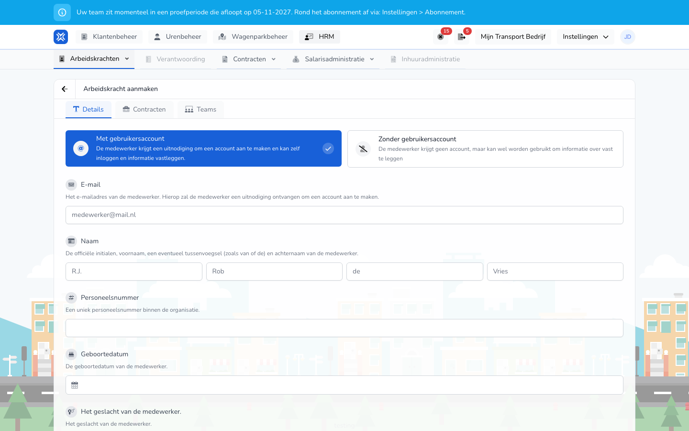

{/* translated-from: nl/management/human-resources/workers/create.mdx sha256:8d78ca5888212ea402f49b6fb16792721a6700ec7648e46cc3d536af1b3b6521 */}

import { Hint } from '/snippets/hint.jsx';

## Wofür diese Seite da ist

Hier fügen Sie eine Arbeitskraft hinzu: die Person, den Vertrag und die Teams, zu denen die Arbeitskraft gehört.

## Screenshot

## Wer das nutzen darf

- Ein Administrator oder Manager der Organisation.

## So nutzen Sie diese Seite

1. Öffnen Sie **Personal** → **Arbeitskräfte** und klicken Sie auf **Neuer Mitarbeiter**.
2. Wählen Sie auf dem Tab **Details**, ob die Arbeitskraft ein Konto erhält: `Met gebruikersaccount` oder `Zonder gebruikersaccount`.
3. Tragen Sie die Daten der Person ein.
4. Öffnen Sie den Tab **Verträge**, klicken Sie auf `+` und tragen Sie den Vertrag ein.
5. Öffnen Sie den Tab **Teams** und haken Sie die Teams an.
6. Klicken Sie auf **Neuer Mitarbeiter**.

## Felder

Tab **Details**:

| Feld | Was Sie eintragen |
|------|--------------|
| `Met gebruikersaccount` / `Zonder gebruikersaccount` (Pflicht) | Mit einem Konto kann sich die Arbeitskraft selbst anmelden und Daten erfassen. Ohne Konto erfassen Sie nur Daten über die Arbeitskraft. |
| **E-Mail** | Nur mit einem Konto, und dann Pflicht. An diese Adresse erhält die Arbeitskraft die Einladung. |
| **Name** (Pflicht) | Initialen, Vorname, gegebenenfalls Namenszusatz und Nachname. Der Namenszusatz ist nicht Pflicht. |
| **Personalnummer** | Eine eindeutige Nummer innerhalb Ihrer Organisation. |
| **Geburtsdatum** | Das Geburtsdatum. |
| Geschlecht | **Mann**, **Frau** oder **Divers**. |
| **Fahrerkartencode (Fahrtenschreiber)** | Der Code der Fahrerkarte des Fahrers. <Hint kind="grey">Dieses Feld, **Wohnadresse** und **Standorte** sehen Sie, wenn Telematik für Ihre Organisation aktiviert ist.</Hint> |
| **Wohnadresse** | Die Wohnadresse. |
| **Standorte** | Pro Standortart, etwa `Standplaatsen` und `Kantoren`, welche Standorte für diese Arbeitskraft gelten. |

Tab **Verträge**, pro Vertrag:

| Feld | Was Sie eintragen |
|------|--------------|
| **Vertragsverhältnis** (Pflicht) | **Mitarbeitende:r**, **Selbstständiger (ZZP)** oder **Charter**. |
| **Start** (Pflicht) | Das Datum, an dem der Vertrag beginnt. |
| **Ende** | Das Datum, an dem der Vertrag endet. Leer bedeutet laufend. |
| **Vertragsart** | Bei einem Mitarbeitenden: **Arbeitnehmer auf Abruf**, **Teilzeitmitarbeiter** oder **Vollzeitmitarbeiter**. |
| **Art der vereinbarten Arbeitszeit** | **Feste Stunden** oder **Min-Max-Stunden**. |
| **Vertragsstunden** | Die Anzahl der Stunden pro Woche. <Hint kind="yellow">Ein Vollzeitmitarbeiter hat immer 40 Stunden, ein Arbeitnehmer auf Abruf 0. Was die Stunden für die Gehaltsberechnung bedeuten, hängt vom Tarifvertrag (CAO) oder der Vertragseinstellung ab.</Hint> |

Tab **Teams**: Haken Sie die Teams an. Mit **Alle auswählen** wählen Sie alle Teams. Sie wählen aus den Teams, die Sie verwalten, und mindestens eines.

## Was danach passiert

- Sie kehren zur Übersicht mit der neuen Arbeitskraft zurück.
- Mit einem Konto erhält die Arbeitskraft eine E-Mail mit **Einladung annehmen**. Solange sie nicht angenommen wurde, steht die Einladung unter [Einladungen](/de/management/human-resources/workers/invitations).

## Einschränkungen

- Eine Arbeitskraft benötigt mindestens einen Vertrag. Verträge dürfen sich nicht überschneiden.
- Eine E-Mail-Adresse, die bereits eine offene Einladung hat oder bereits zu Ihrer Organisation gehört, können Sie nicht noch einmal verwenden.
