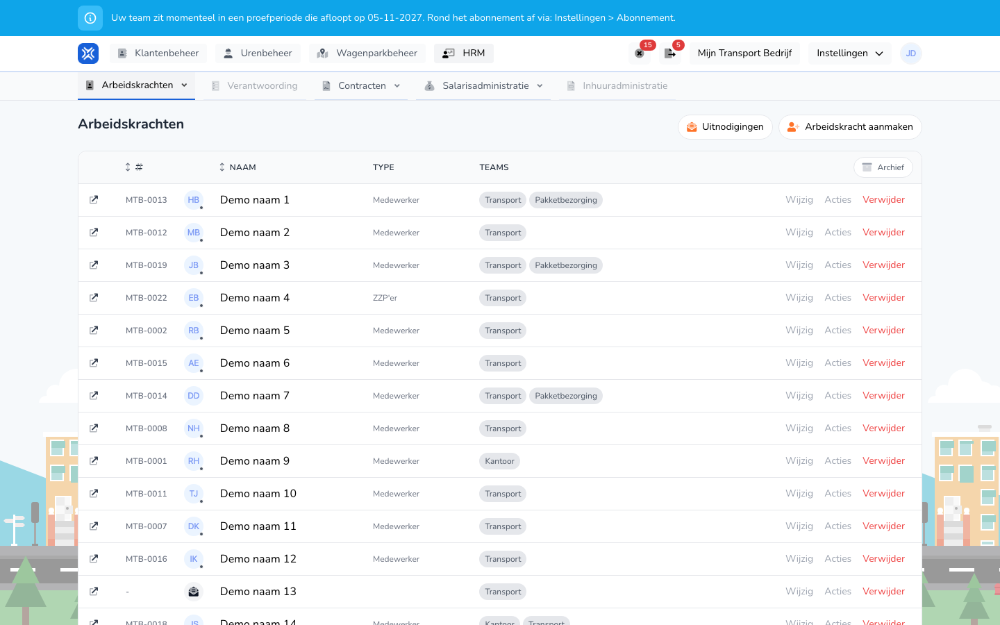

{/* translated-from: nl/management/human-resources/workers/overview.mdx sha256:629d4cf0cedc554799d3a0dd9d2c3cde9099c080506260a000232beed05b452a */}

## Wofür diese Seite da ist

Hier sehen und verwalten Sie die Mitarbeitenden Ihrer Organisation.

## Was Sie hier tun können

- Mitarbeitende ansehen.
- Einen neuen Mitarbeitenden hinzufügen.
- Einen Mitarbeitenden ändern, Aktionen öffnen oder löschen.

## Screenshot

## Was Sie auf der Seite sehen

- Die Schaltfläche **Neuer Mitarbeiter**.
- Eine Tabelle mit Name, Typ, Vertragsstunden und Vertragsende.
- Aktionen wie **Bearbeiten**, **Aktionen** und **Entfernen**.

## So nutzen Sie diese Seite

1. Öffnen Sie **Personal**.
2. Suchen Sie den Mitarbeitenden, den Sie benötigen.
3. Verwenden Sie **Bearbeiten**, um Daten anzupassen.
4. Verwenden Sie **Neuer Mitarbeiter**, um jemanden hinzuzufügen.

## Was danach passiert

- Änderungen werden in der Mitarbeiterübersicht verarbeitet.
- Neue Mitarbeitende erscheinen danach in der Liste.

## Wichtig zu wissen

- Prüfen Sie vor allem die Vertragsdaten sorgfältig.
- Verwenden Sie die Zeilenaktionen, um Folgeaktionen auszuführen.

## Verwandte Seiten

- Dashboard
- Übersicht der Rechenschaftslegung

