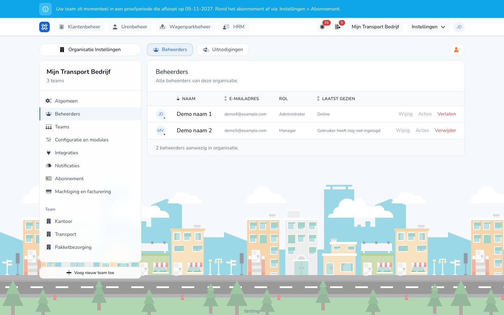

{/* translated-from: nl/settings/organization/administrators.mdx sha256:896eb6ae26f931a378b0cdf3ffa15127ae58ed53ed14ed87edfee89d7de02d59 */}

import { Hint } from '/snippets/hint.jsx';

## Wofür diese Seite da ist

Hier verwalten Sie, wer Ihre Organisation verwaltet: die Administratoren und Manager. Mitarbeitende, die nur Stunden erfassen, verwalten Sie unter [Arbeitskräfte](/de/management/human-resources/workers/overview).

## Screenshot

## Wer das nutzen darf

- Ein Administrator der Organisation.

## So nutzen Sie diese Seite

Jemanden einladen:

1. Öffnen Sie **Einstellungen** → **Organisationseinstellungen** → **Administratoren**.
2. Klicken Sie oben rechts auf die Schaltfläche mit dem Personen-Plus-Symbol.
3. Tragen Sie die **E-Mail** ein, wählen Sie die **Rolle** und, wenn Sie mehrere Teams haben, die **Teams**.
4. Klicken Sie auf **Einladen**.

Jemanden ändern oder entfernen:

1. Klicken Sie auf dem Tab **Administratoren** in der Zeile der Person auf **Bearbeiten**.
2. Passen Sie unter **Daten** den **Vollständiger Name** an, oder unter **Berechtigungen** die **Rolle** und die **Teams**, und klicken Sie auf **Speichern**.
3. Klicken Sie auf **Entfernen**, um jemanden aus der Organisation zu entfernen, und bestätigen Sie.

## Felder

| Spalte | Bedeutung |
|-------|-----------|
| **Name** | Der Name des Administrators oder Managers. |
| **E-Mail-Adresse** | Die E-Mail-Adresse, mit der sich die Person anmeldet. |
| **Rolle** | **Administrator** oder **Manager**. |
| **Zuletzt gesehen** | **Online**, wie lange die Person zuletzt aktiv war, oder **Der Benutzer hat sich noch nicht angemeldet**. |

Bei einer Einladung:

| Feld | Was Sie eintragen |
|------|--------------|
| **E-Mail** (Pflicht) | Die Adresse, an die die Einladung geht. |
| **Rolle** (Pflicht) | **Administrator** oder **Manager**. |
| **Teams** | Die Teams, auf die die Person zugreifen kann. Mindestens eines. Dieses Feld sehen Sie, wenn Ihre Organisation mehr als ein Team hat. |

Was eine Rolle darf:

| Rolle | Was diese Rolle darf |
|-----|------------------|
| **Administrator** | Die gesamte Organisation verwalten: alle Einstellungen, Administratoren, Abonnement und Rechnungen und alles, was ein Manager darf. |
| **Manager** | Zeiteinträge ansehen, genehmigen, ablehnen, erstellen und exportieren, für die Teams, zu denen der Manager gehört. |

Ein Mitarbeitender erhält hier keine Rolle. Ein Mitarbeitender erfasst eigene Zeiteinträge und erhält ein Konto, wenn Sie den Mitarbeitenden mit einem Konto anlegen. Siehe [Arbeitskraft anlegen](/de/management/human-resources/workers/create).

## Was danach passiert

- Die Einladung steht auf dem Tab **Einladungen**, bis sie angenommen wird. Dort können Sie sie **Erneut senden** oder **Abbrechen**.
- Nach dem Annehmen steht die Person auf dem Tab **Administratoren**.
- Mit **Verlassen** in Ihrer eigenen Zeile verlassen Sie selbst die Organisation.
- Die Berechtigungen ergeben sich direkt aus der Rolle. Sie schalten keine einzelnen Berechtigungen pro Person ein oder aus.
- Mit **Teams** beschränken Sie einen Manager auf bestimmte Teams. Wählen Sie alle Teams, gilt die Rolle für die gesamte Organisation.

## Einschränkungen

- Eine Organisation behält immer mindestens einen Administrator. <Hint kind="red">Den letzten Administrator können Sie nicht entfernen.</Hint>
- Ihre eigene Rolle und Ihre eigenen Teams können Sie nicht selbst ändern.
- Ein Manager sieht das Menü **Organisationseinstellungen** nicht.
- Eine E-Mail-Adresse, die bereits eine Einladung hat oder bereits zur Organisation gehört, können Sie nicht noch einmal einladen.
