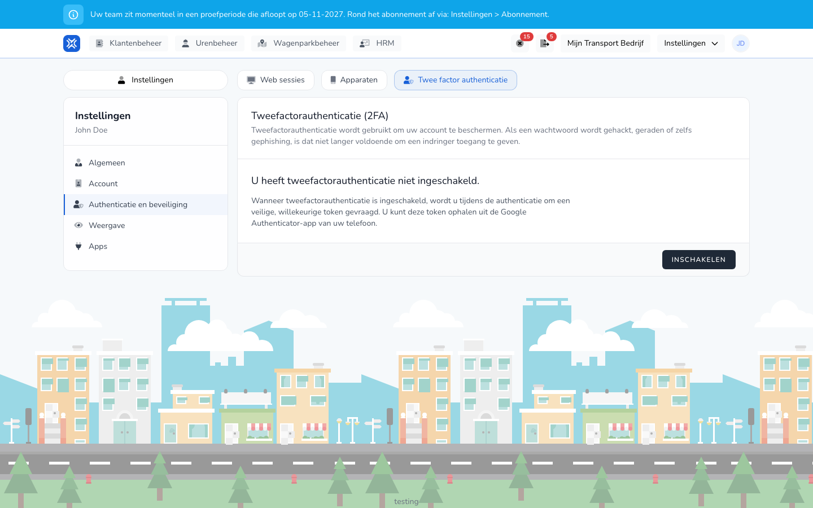

{/* translated-from: nl/settings/user/authentication-and-security/two-factor-authentication.mdx sha256:ccb27f71b5b08c80e9f6aad1ab3f90d680c5ab7c260da760e48ef48c21779625 */}

import { Hint } from '/snippets/hint.jsx';

## Wofür diese Seite da ist

Hier schalten Sie die Zwei-Faktor-Authentifizierung ein. TransportKlok verlangt dann bei der Anmeldung zusätzlich einen Code aus einer App auf Ihrem Telefon.

## Screenshot

## Wer das nutzen darf

- Jeder Benutzer, für das eigene Konto.

## So nutzen Sie diese Seite

1. Klicken Sie oben rechts auf Ihre Initialen und wählen Sie **Einstellungen** → **Authentifizierung und Sicherheit**.
2. Öffnen Sie den Tab **Zwei-Faktor-Authentifizierung** und klicken Sie auf **Aktivieren**.
3. Scannen Sie den QR-Code mit einer Authenticator-App auf Ihrem Telefon, etwa Google Authenticator. Oder kopieren Sie den **Einrichtungsschlüssel** in die App.
4. Tragen Sie den 6-stelligen **Authentifizierungscode** aus der App ein und klicken Sie auf **Einrichtung bestätigen**.
5. Bewahren Sie die Wiederherstellungscodes an einem sicheren Ort auf. <Hint kind="red">Mit einem Wiederherstellungscode kommen Sie in Ihr Konto, wenn Sie Ihr Telefon verlieren. Ohne Wiederherstellungscode ist das nicht möglich.</Hint>

## Felder

| Was Sie sehen | Bedeutung |
|------------|-----------|
| Status | Ob die Zwei-Faktor-Authentifizierung eingeschaltet ist. |
| **Wiederherstellungscodes anzeigen** | Zeigt Ihre Wiederherstellungscodes. |
| **Wiederherstellungscodes neu generieren** | Erstellt neue Wiederherstellungscodes. |
| **QR-Code anzeigen** | Zeigt den QR-Code erneut. |
| **Deaktivieren** | Schaltet die Zwei-Faktor-Authentifizierung aus. |

## Was danach passiert

- Bei der Anmeldung verlangt TransportKlok zusätzlich einen Code aus der App. Siehe [Anmeldung mit Zwei-Faktor-Authentifizierung](/de/sign-in/two-factor).
- Nach dem Einschalten werden Sie auf Ihren anderen Geräten und Browsern abgemeldet. Danach melden Sie sich dort erneut mit dem Code an.

## Einschränkungen

- Für Wiederherstellungscodes, den QR-Code und das Ausschalten fragt TransportKlok zuerst nach Ihrem Passwort.
