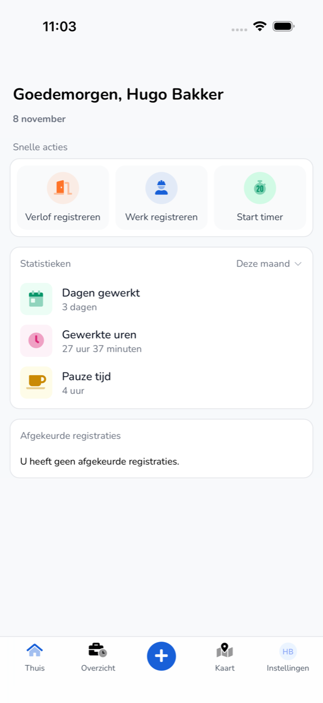

{/* translated-from: nl/workforce/app/home.mdx sha256:d3e31ca7eb3ad73d3658d65d9a53908d8f99b9935524291c537fc28361f2a3b3 */}

## Wofür diese Seite da ist

Die **Startseite** ist der erste Bildschirm nach der Anmeldung. Hier starten Sie einen Eintrag und sehen, wie viel Sie gearbeitet haben.

## Screenshot

## Wer das nutzen darf

- Jeder Mitarbeitende, der die App nutzt.

## So nutzen Sie diese Seite

1. Tippen Sie unten auf **Startseite**.
2. Wählen Sie unter **Schnelle Aktionen**, was Sie tun möchten:
   - **Urlaub registrieren**. Siehe [Urlaub registrieren](/de/workforce/app/register-leave).
   - **Arbeit registrieren**. Siehe [Arbeit registrieren](/de/workforce/app/register-work).
   - **Timer starten**. Siehe [Timer](/de/workforce/app/timer).
3. Wählen Sie unter **Statistiken** den Zeitraum, zum Beispiel **Diesen Monat**.
4. Sehen Sie unter **Abgelehnte Zeiteinträge** nach, ob Ihr Arbeitgeber Einträge abgelehnt hat.

## Felder

| Bereich | Was Sie sehen |
|-----------|------------|
| **Gearbeitete Tage** | Die Anzahl der Tage, die Sie im gewählten Zeitraum gearbeitet haben. |
| **Gearbeitete Stunden** | Ihre gearbeiteten Stunden im gewählten Zeitraum. |
| **Pausenzeit** | Ihre Pausen im gewählten Zeitraum. |
| **Abgelehnte Zeiteinträge** | Ihre Einträge, die abgelehnt wurden, oder „Sie haben keine abgelehnten Einträge." |

Unten befindet sich die Menüleiste:

| Schaltfläche | Was Sie dort tun |
|------|-----------------|
| **Startseite** | Zurück zu diesem Bildschirm. |
| **Übersicht** | Ihre Einträge pro Woche. Siehe [Übersicht](/de/workforce/app/overview). |
| `+` | Einen neuen Eintrag erstellen. Siehe [Arbeit registrieren](/de/workforce/app/register-work). |
| **Karte** | Kolleginnen und Kollegen, Fahrzeuge und Anhänger auf der Karte. Siehe [Karte](/de/workforce/app/map). |
| **Einstellungen** | Ihr Profil, Ihr Konto und die Sicherheit. Siehe [Einstellungen](/de/workforce/app/settings). |

## Was danach passiert

- Einen abgelehnten Eintrag passen Sie über die [Übersicht](/de/workforce/app/overview) an.

## Einschränkungen

- Hier sehen Sie nur Ihre eigenen Stunden und Einträge.
- **Timer starten** sehen Sie nur, wenn Ihre Organisation am Beta-Programm teilnimmt.
