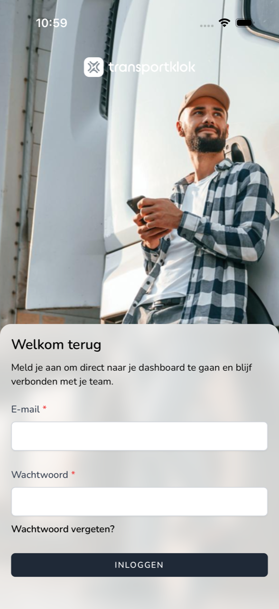
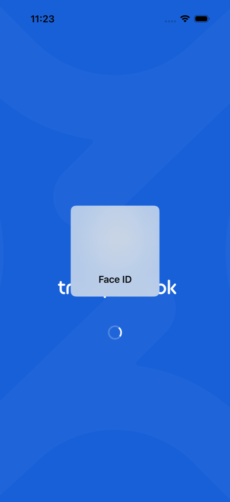

{/* translated-from: nl/workforce/app/login.mdx sha256:f872462220821e6db2e363ef810da1a8dec376bf94e20b3e450d2b0d24cd21ce */}

import { Hint } from '/snippets/hint.jsx';

## Wofür diese Seite da ist

Hier lesen Sie, wie Sie sich in der TransportKlok-App auf Ihrem Telefon anmelden und wie die App danach Ihr Gesicht oder Ihren Fingerabdruck verwendet.

## Screenshot

## Wer das nutzen darf

- Jeder Mitarbeitende mit einem TransportKlok-Konto. Haben Sie noch kein Konto, nehmen Sie zuerst die Einladung Ihres Arbeitgebers an. Siehe [Einladung annehmen](/de/sign-in/accept-invitation).

## So nutzen Sie diese Seite

Anmelden:

1. Öffnen Sie die TransportKlok-App. Sie sehen **Willkommen zurück**.
2. Tragen Sie Ihre **E-Mail** und Ihr **Passwort** ein und tippen Sie auf **Anmelden**.
3. Hat Ihr Telefon Face ID, Touch ID oder einen Fingerabdruck eingerichtet, fragt das Telefon jetzt danach. Schauen Sie auf Ihr Telefon oder legen Sie Ihren Finger auf den Sensor.
4. Ist die Zwei-Faktor-Authentifizierung eingeschaltet, tragen Sie den Code aus Ihrer Authenticator-App ein und tippen Sie auf **Anmelden**. Haben Sie die App nicht zur Hand, tippen Sie auf `Use a recovery code` und tragen Sie einen Wiederherstellungscode ein.

Passwort vergessen:

1. Tippen Sie auf **Passwort vergessen?**.
2. Tragen Sie Ihre E-Mail-Adresse ein und tippen Sie auf **Passwort-Reset-Link per E-Mail senden**.
3. Öffnen Sie die E-Mail und legen Sie ein neues Passwort fest. Tippen Sie danach in der App auf **Zurück zum Login**.

## Felder

| Feld | Was Sie eintragen |
|------|--------------|
| **E-Mail** | Die E-Mail-Adresse Ihres TransportKlok-Kontos. |
| **Passwort** | Ihr Passwort. |

## Was danach passiert

- Nach der Anmeldung fragt die App einmal, ob Sie Push-Benachrichtigungen möchten. Siehe [Push-Benachrichtigungen](/de/workforce/app/push-notifications). Danach sehen Sie die **Startseite**. Siehe [Startseite](/de/workforce/app/home).
- Haben Sie Face ID oder einen Fingerabdruck, fragt die App auch danach, wenn Sie die App später wieder öffnen und wenn Ihre Sitzung erneuert wird. Sie müssen dann Ihr Passwort nicht erneut eintragen.

- Sehen Sie **Schneller und sicherer Login**, tippen Sie auf `Gezichts-ID inschakelen` (oder den Namen Ihres Fingerabdrucks), um dies einzuschalten, oder auf **Überspringen**.
- Haben Sie Ihre E-Mail-Adresse noch nicht bestätigt, fragt die App danach. Klicken Sie auf den Link in der E-Mail und tippen Sie auf **Aktualisieren**, oder tippen Sie auf **Bestätigungs-E-Mail erneut senden**.

## Einschränkungen

- Nach einigen falschen Versuchen sehen Sie „Zu viele Anmeldeversuche. Bitte warten Sie 1 Minute."
- Sehen Sie beim Öffnen `Sessie niet hersteld`, tippen Sie auf `Opnieuw inloggen` und melden Sie sich mit Ihrer E-Mail-Adresse und Ihrem Passwort an.
- Haben Sie weder Face ID, Touch ID noch einen Fingerabdruck eingerichtet, melden Sie sich nur mit Ihrem Passwort an. <Hint kind="grey">Schalten Sie später Face ID oder einen Fingerabdruck auf Ihrem Telefon ein, verwendet die App dies ab der nächsten Anmeldung.</Hint>
