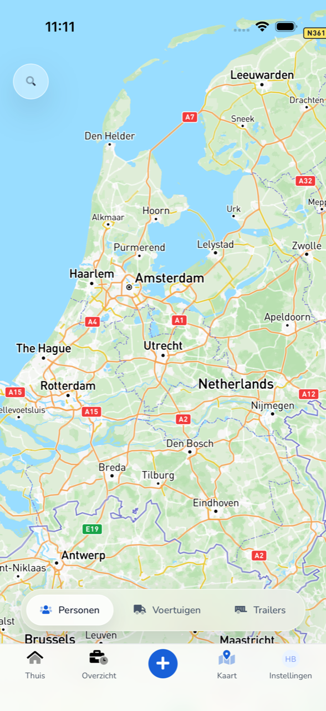
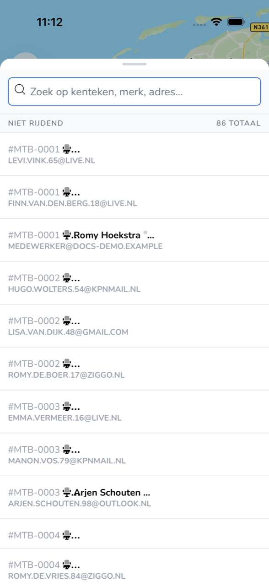

{/* translated-from: nl/workforce/app/map.mdx sha256:3f984df70bf62f5a16c8250c5b3445e9b38c215f49e71bed769a63e657b90a77 */}

## Wofür diese Seite da ist

Auf der **Karte** sehen Sie, wo sich Kolleginnen und Kollegen, Fahrzeuge und Anhänger Ihrer Organisation befinden.

## Screenshot

## Wer das nutzen darf

- Jeder Mitarbeitende, der die App nutzt.

## So nutzen Sie diese Seite

1. Tippen Sie unten auf **Karte**.
2. Wählen Sie unten **Personen**, **Fahrzeuge** oder **Anhänger**.
3. Tippen Sie oben links auf die Lupe, um die Liste zu öffnen.
4. Suchen Sie nach Kennzeichen, Marke oder Adresse.

## Felder

| Bereich | Was Sie sehen |
|-----------|------------|
| **Personen** | Kolleginnen und Kollegen mit ihrem Fahrzeug. |
| **Fahrzeuge** | Die Fahrzeuge Ihrer Organisation. |
| **Anhänger** | Die Anhänger Ihrer Organisation. |
| Gruppe, etwa **Nicht in Bewegung** | Ob jemand oder etwas fährt. Rechts steht die Summe. |

## Was danach passiert

- Mit **Personen**, **Fahrzeuge** oder **Anhänger** wechseln Sie, was die Karte und die Liste anzeigen.

## Einschränkungen

- Auf der Karte schauen Sie nur. Fahrzeuge und Anhänger ändert Ihr Arbeitgeber in TransportKlok.
