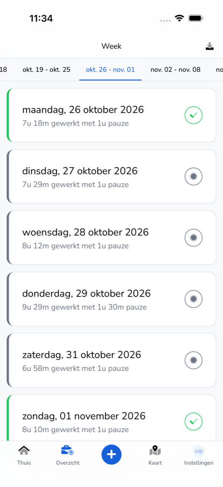
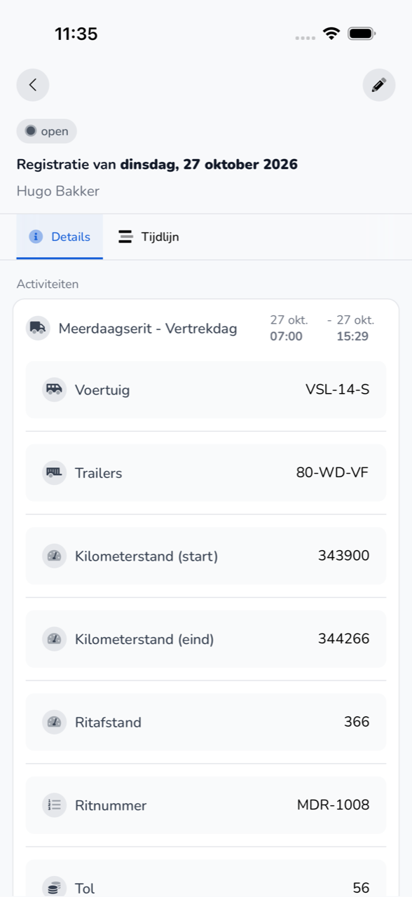

{/* translated-from: nl/workforce/app/overview.mdx sha256:cd32ebb743bdf09617ea72c35984c933fa3010a16f59fc7d0ac65fcc2799f798 */}

import { Hint } from '/snippets/hint.jsx';

## Wofür diese Seite da ist

In der **Übersicht** sehen Sie Ihre Einträge pro Woche. Hier öffnen Sie einen Eintrag und ändern einen, der noch offen ist.

## Screenshot

## Wer das nutzen darf

- Jeder Mitarbeitende, der die App nutzt, für die eigenen Einträge.

## So nutzen Sie diese Seite

Einen Eintrag ansehen:

1. Tippen Sie unten auf **Übersicht**.
2. Wählen Sie oben die Woche.
3. Tippen Sie auf einen Tag. Sie sehen den Eintrag mit den Tabs **Details** und **Verlauf**.

Einen Eintrag ändern:

1. Öffnen Sie einen Eintrag, der noch offen ist.
2. Tippen Sie oben rechts auf den Stift.
3. Passen Sie die Daten an und tippen Sie auf **Abschließen**.

## Felder

| Bereich | Was Sie sehen |
|-----------|------------|
| Tag | Das Datum, wie viel Sie gearbeitet haben und wie viel Pause Sie hatten. |
| Grüner Haken | Der Eintrag wurde genehmigt. |
| Grauer Punkt | Der Eintrag ist offen und wartet auf Genehmigung. |
| **Summe** | Ihre gearbeiteten Stunden, Pausen und Abwesenheit in dieser Woche. |
| **Details** | Die Tätigkeiten mit Zeiten, Fahrzeug und Fahrtdaten sowie Ihre Pause. |
| **Verlauf** | Wer den Eintrag wann angelegt, geändert oder genehmigt hat. |

## Was danach passiert

- Nach einer Änderung sehen Sie „Zeiteintrag aktualisiert".
- Ein genehmigter Eintrag erhält einen grünen Haken.

## Einschränkungen

- Nur einen Eintrag, der offen ist, können Sie ändern. <Hint kind="yellow">Ist ein Eintrag bereits genehmigt und stimmt etwas nicht, bitten Sie Ihren Arbeitgeber, ihn anzupassen.</Hint>
