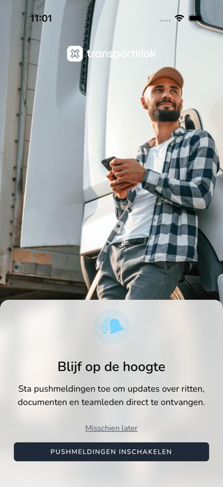

{/* translated-from: nl/workforce/app/push-notifications.mdx sha256:411d08cec7befaf6239f0ed999992cd57991126ebce8493c60b121f6830f2786 */}

## Wofür diese Seite da ist

Mit Push-Benachrichtigungen erhalten Sie Nachrichten von TransportKlok auf Ihrem Telefon, auch wenn die App geschlossen ist. Hier lesen Sie, wie Sie sie einschalten.

## Screenshot

## Wer das nutzen darf

- Jeder Mitarbeitende, der die App nutzt.

## So nutzen Sie diese Seite

1. Nach Ihrer ersten Anmeldung sehen Sie **Bleiben Sie informiert**.
2. Tippen Sie auf **Push-Benachrichtigungen aktivieren**.
3. Ihr Telefon fragt, ob TransportKlok Benachrichtigungen senden darf. Tippen Sie auf `Sta toe` (unter Android: **Zulassen**).

Möchten Sie dies später entscheiden, tippen Sie auf **Vielleicht später**.

## Felder

| Schaltfläche | Was passiert |
|------|----------------|
| **Push-Benachrichtigungen aktivieren** | Ihr Telefon fragt um Erlaubnis für Benachrichtigungen. |
| **Vielleicht später** | Sie fahren ohne Benachrichtigungen fort. Die App fragt später noch einmal. |

## Was danach passiert

- Mit Erlaubnis erhalten Sie Benachrichtigungen von TransportKlok auf Ihrem Telefon.
- Haben Sie **Vielleicht später** gewählt, fragt die App nach einiger Zeit erneut mit `Push notificaties`.

## Einschränkungen

- Haben Sie Benachrichtigungen in der Abfrage Ihres Telefons abgelehnt, schalten Sie sie nur in den Einstellungen Ihres Telefons, bei TransportKlok, wieder ein. Die App zeigt dann `Push notificaties uitgeschakeld` als Erinnerung.
