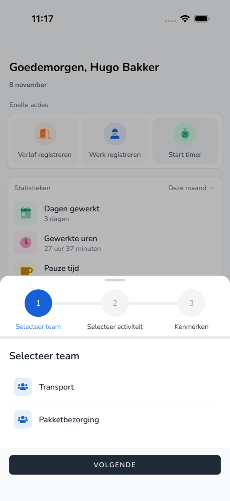

{/* translated-from: nl/workforce/app/timer.mdx sha256:bbcf1e5cd80cfec63ecccdececf01bce9eb074203a25f6146cafda5417818840 */}

import { Hint } from '/snippets/hint.jsx';

## Wofür diese Seite da ist

Mit dem Timer halten Sie Ihre Arbeit fest, während Sie arbeiten. Sie starten den Timer zu Beginn und stoppen ihn, wenn Sie fertig sind.

## Screenshot

## Wer das nutzen darf

- Mitarbeitende einer Organisation, die am Beta-Programm teilnimmt. <Hint kind="grey">Nimmt Ihre Organisation nicht teil, sehen Sie **Timer starten** nicht.</Hint>

## So nutzen Sie diese Seite

1. Tippen Sie auf der **Startseite** auf **Timer starten**.
2. Wählen Sie bei **Team auswählen** Ihr Team und tippen Sie auf **Weiter**.
3. Wählen Sie bei **Aktivität auswählen**, was Sie tun werden, und tippen Sie auf **Weiter**.
4. Tragen Sie bei **Eigenschaften** gegebenenfalls eine **Notiz** ein und tippen Sie auf **Starten**.

## Felder

| Schaltfläche | Was passiert |
|------|----------------|
| **Stopp** | Der Timer stoppt und die Zeit wird zu einem Eintrag. |
| **Wechseln** | Sie beenden die aktuelle Aktivität und starten eine andere. |
| **Angaben bearbeiten** | Sie passen die Daten der laufenden Aktivität an. |
| **Entfernen** | Sie löschen den laufenden Eintrag. |

## Was danach passiert

- Auf der **Startseite** steht die **Aktive Aufnahme** mit der laufenden Zeit.
- Nach **Stopp** steht der Eintrag in der [Übersicht](/de/workforce/app/overview).

## Einschränkungen

- Wurde der Timer außerhalb der App gestartet, können Sie ihn in der App nicht ändern oder stoppen.
- Ist der Abrechnungszeitraum von heute bereits verarbeitet, startet der Timer nicht.
