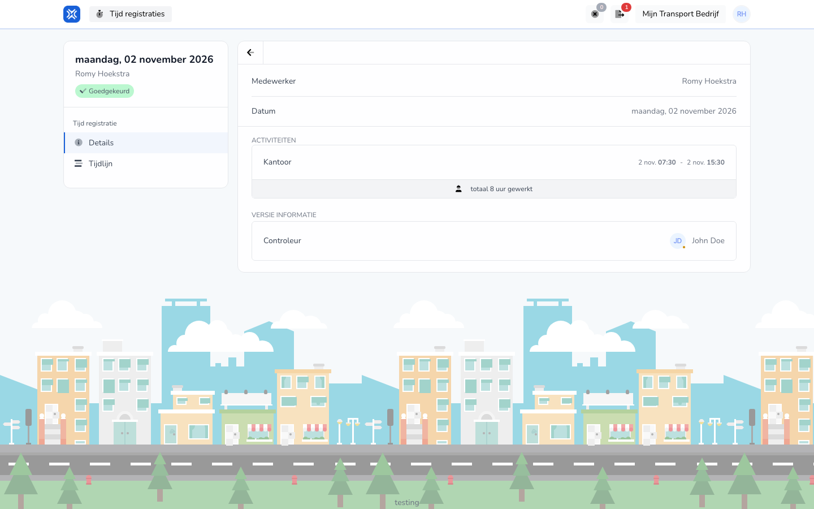

{/* translated-from: nl/workforce/hour-management/time-registrations/details.mdx sha256:7e34bd81d4100dc1226c633b2f917bc9bee9e93f97557dd87703f1f2d76384e8 */}

## Wofür diese Seite da ist

Auf dieser Seite sehen Sie den Inhalt eines bestehenden Eintrags.

## Was Sie hier tun können

- Einen Eintrag durchlesen.
- Prüfen, ob die eingetragenen Daten stimmen.

## Screenshot

## Was Sie auf der Seite sehen

- Die Details eines Eintrags.
- Die ausgefüllten Daten dieses Eintrags.

## So nutzen Sie diese Seite

1. Öffnen Sie einen bestehenden Eintrag aus Ihrer Übersicht.
2. Lesen Sie die Daten in Ruhe durch.
3. Gehen Sie nur zum Bearbeiten weiter, wenn etwas angepasst werden muss.

## Was danach passiert

- Sie wissen, ob Ihr Eintrag stimmt oder noch angepasst werden muss.

## Wichtig zu wissen

- Nutzen Sie diese Seite vor allem zur Kontrolle.
- Ändern Sie erst etwas, wenn Sie sicher wissen, was falsch ist oder sich geändert hat.

## Verwandte Seiten

- Übersicht der Zeiteinträge
- Zeiteintrag bearbeiten
- Verlauf des Zeiteintrags

