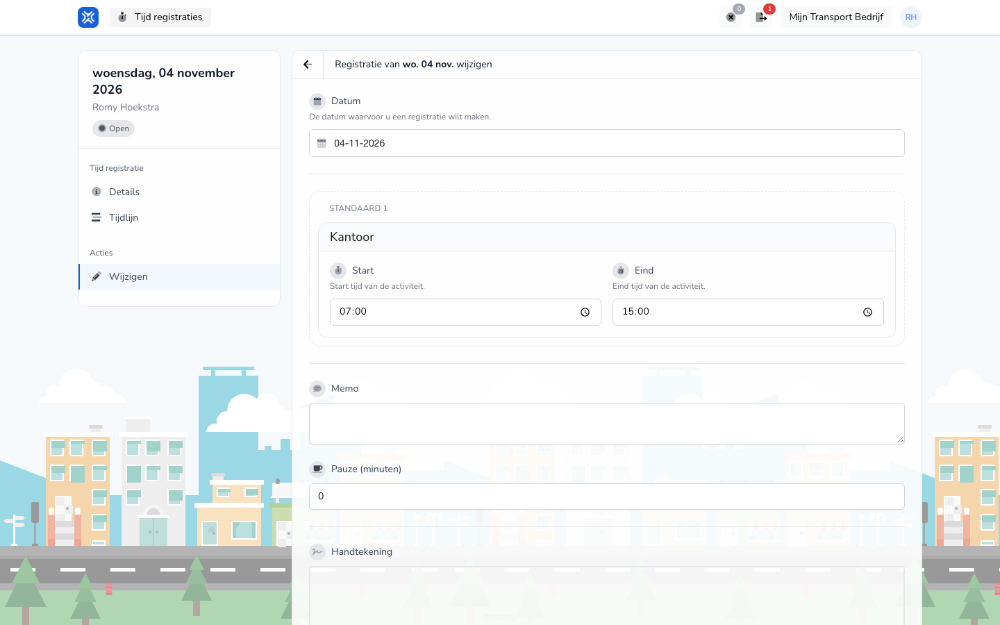

{/* translated-from: nl/workforce/hour-management/time-registrations/edit.mdx sha256:3f9a43e76b5737c9f45e4f9e4cb052e942ebf147df88641b1ac36d8894b48adc */}

## Wofür diese Seite da ist

Mit dieser Seite passen Sie einen bestehenden Eintrag an.

## Was Sie hier tun können

- Daten korrigieren.
- Einen Eintrag ergänzen.

## Screenshot

## Was Sie auf der Seite sehen

- Ein Formular mit bestehenden Werten.
- Eingaben, die den Schritten zum Erstellen ähneln.

## So nutzen Sie diese Seite

1. Öffnen Sie den bestehenden Eintrag.
2. Ändern Sie nur die Felder, die sich ändern müssen.
3. Prüfen Sie alles noch einmal.
4. Speichern Sie die Änderung.

## Was danach passiert

- Ihr angepasster Eintrag erscheint danach mit den neuen Daten in der Übersicht.

## Wichtig zu wissen

- Prüfen Sie vor dem Speichern vor allem Datum, Zeiten und Tätigkeiten.

## Verwandte Seiten

- Übersicht der Zeiteinträge
- Details des Zeiteintrags

