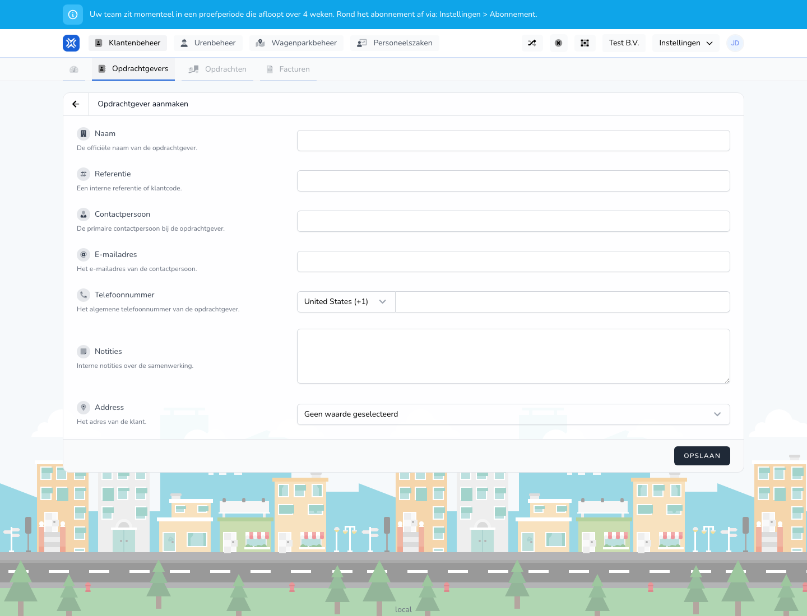

{/* translated-from: nl/management/customer-management/customers/create.mdx sha256:f5b32cca0d6759ecf68af1b74403b567bb768ac17f85e6c013a8ef59f691f2ba */}

## What this page is for

With this form you add a new client.

## What you can do here

- Fill in the name, reference and contact details.

## Screenshot

## What you see on the page

- Fields for name, reference, contact person, email address and phone number.

## How to use this page

1. Open **New client**.
2. Fill in the official name.
3. Add the internal reference if you use one.
4. Fill in the contact person and contact details.
5. Save the client.

## What happens next

- The client appears in the overview.
- You can then use this client in other processes.

## Good to know

- Use contact details that colleagues can also use directly.
- Check the email address and phone number extra carefully.

## Related pages

- Clients overview
- Edit client

