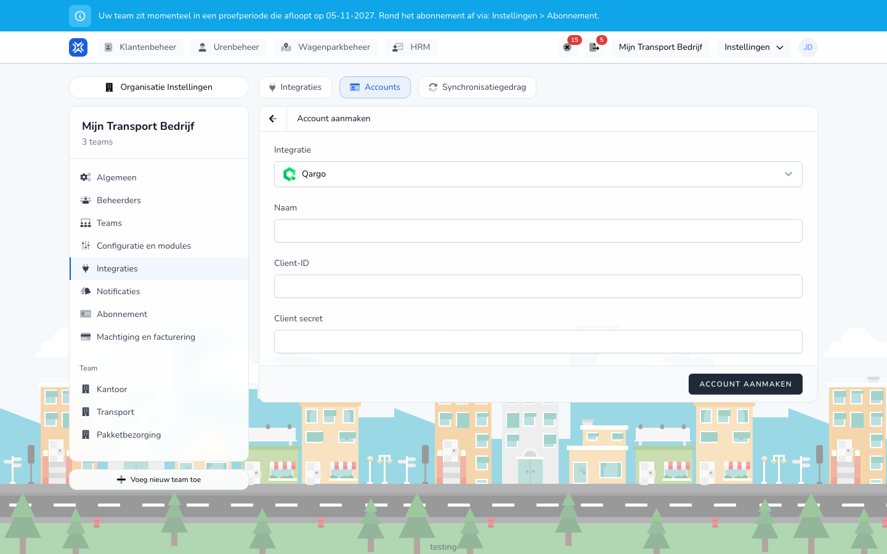

{/* translated-from: nl/management/customer-management/integrations/qargo.mdx sha256:4387ab77afd7c9a116a23b0e1a7511989cda383eb413d48add04eef7a52eb409 */}

import { Hint } from '/snippets/hint.jsx';

## What this page is for

With the Qargo integration, TransportKlok imports your customers from Qargo as clients, with their billing address as a location.

## Screenshot

## Who can use this

- An administrator or manager of the organization.
- The organization needs the **Client management** module.

## How to use this page

1. Open **Settings** → **Organization settings** → **Integrations** and choose the **Accounts** tab.
2. Click **Create Account** and choose **Qargo** under **Integration**.
3. Fill in a **Name**, the **Client ID** and the **Client secret** of your Qargo API user and click **Create Account**.
4. Open the **Integrations** tab, click **Add integration** and click **Connect** next to **Qargo**.
5. Choose the **Account**, give the integration a **Name** and click **Connect**.

## Fields

| Field | What you fill in |
|------|--------------|
| **Name** (required) | The name of the account in the overview. |
| **Client ID** (required) | The Client ID of your Qargo API user. |
| **Client secret** (required) | The secret that belongs to that Client ID. |

<Hint kind="yellow">The API user in Qargo needs the role `API_MASTER_DATA` or `API_ACCOUNTING` to be allowed to read companies. Without that role, TransportKlok rejects the account.</Hint>

## What happens next

| Function | Runs automatically |
|---------|---------------|
| **Synchronize clients** | every day at 03:00 |

- With **Sync** on the **Sync behavior** tab you fetch the customers right away. See [Sync behavior](/en/settings/organization/integrations/capabilities).
- Every customer in Qargo becomes a client in TransportKlok, with the name as **Name**, the customer code as **Reference** and the note as **Notes**. See [Clients](/en/management/customer-management/customers/overview).
- The customer's billing address becomes a location of the type **Customer** for that client.
- The first time, the integration fetches all customers. After that, only the customers that were changed in Qargo.

## Limitations

- The integration only fetches data from Qargo. It does not send anything back.
- Companies in Qargo that are not a customer or are archived are not imported by the integration.
- If you change the name, reference or notes of an imported client in TransportKlok, your change stays. <Hint kind="grey">A field you have not changed follows Qargo at the next synchronization.</Hint>
- If the billing address in Qargo has no coordinates, the client is still imported, but without a location.
- A client or location that you delete in TransportKlok does not come back. <Hint kind="red">The integration does not create a deleted client again.</Hint>
- The integration is in beta. You only see Qargo if your organization takes part in the beta program.
