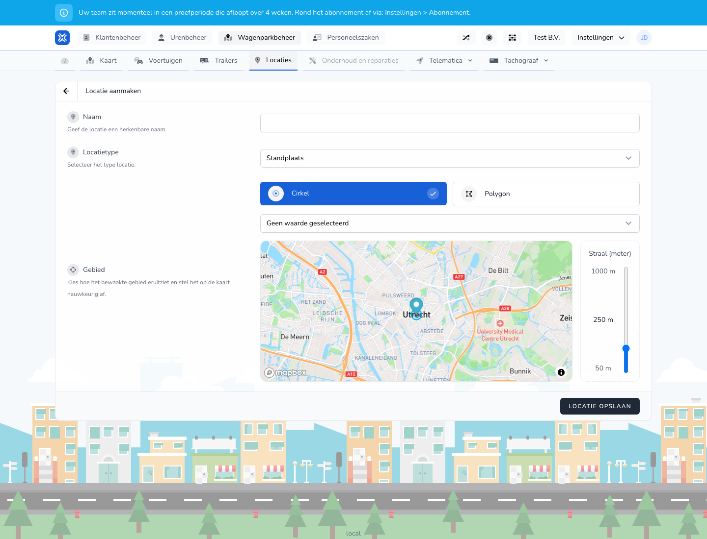

{/* translated-from: nl/management/fleet-management/locations/create.mdx sha256:82f4e0509b7672ac1b9f52629caaf92735f6ca6e6861e9172a1cc5e9349ab94d */}

## What this page is for

With this form you record a new location.

## What you can do here

- Choose a location name.
- Determine the location type.
- Set an area or shape on the map.

## Screenshot

## What you see on the page

- Fields for the name and location type.
- Settings for the area, such as a circle or another monitored area.
- A map section to set the location precisely.

## How to use this page

1. Give the location a clear name.
2. Choose the right location type.
3. Set the area on the map as precisely as possible.
4. Save the location.

## What happens next

- The new location appears in the overview.
- Colleagues can then use the location in relevant processes.

## Good to know

- Work precisely if the map location matters for recognition or registration.
- Use a name that colleagues understand right away.

## Related pages

- Locations overview
- Map

