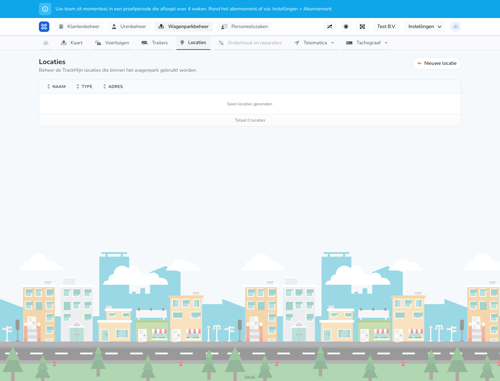

{/* translated-from: nl/management/fleet-management/locations/overview.mdx sha256:b966ab667e0587862ca78e7bc26869c0f7bd9af39984a70e8867f1eb23ada01b */}

## What this page is for

Here you manage the locations used in the fleet.

## What you can do here

- View locations.
- Add a new location.

## Screenshot

## What you see on the page

- The **New location** button.
- A short explanation about using TrackMijn locations.
- A table with name, type and address.

## How to use this page

1. Open **Locations**.
2. Check whether the location already exists.
3. Click **New location** if you want to add another location.

## What happens next

- After adding, the location appears in the overview.
- Locations can then be chosen in other processes.

## Good to know

- If there are no locations yet, you see an empty state with a clear message.
- Use recognizable location names so colleagues can find them easily.

## Related pages

- Create location
- Map

