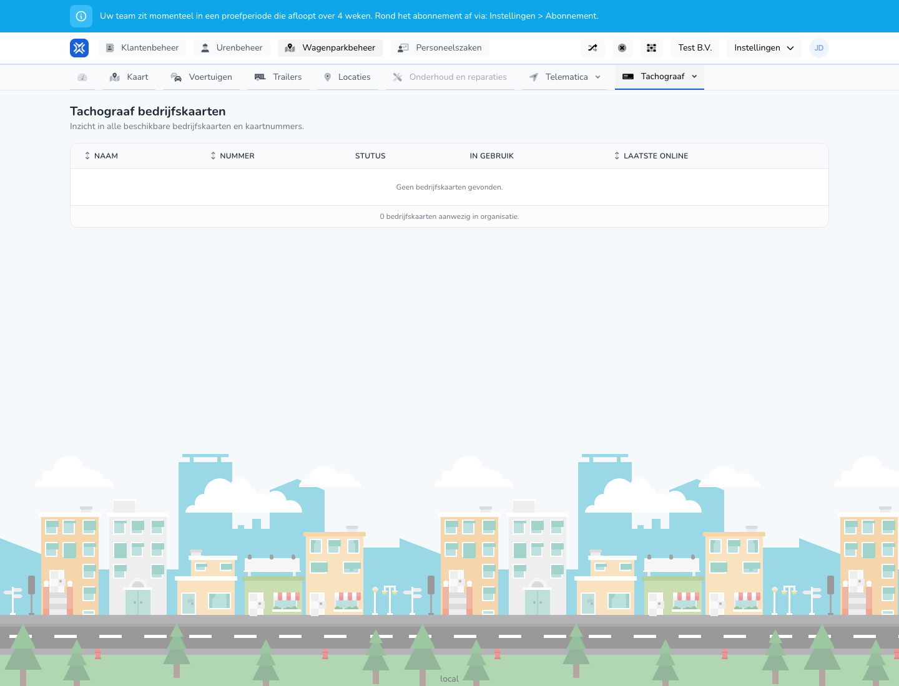

{/* translated-from: nl/management/fleet-management/tachograph/company-cards.mdx sha256:dd4c7035f0c017cdbf973b477f3d4685be97f592cc20e04f0eaa8f2f7d9182ed */}

## What this page is for

Here you see which company cards are available and whether they are in use.

## What you can do here

- Check company cards.
- View card numbers and status.

## Screenshot

## What you see on the page

- A table with name, number, status, in use and last online.

## How to use this page

1. Open **Tachograph company cards**.
2. Check which cards are available.
3. Use status and last online to assess whether a card is still actively used.

## What happens next

- You quickly get insight into the card inventory and card status.

## Good to know

- Mainly use this screen for overview and checking.

## Related pages

- Tachograph vehicles
- Tachograph drivers

