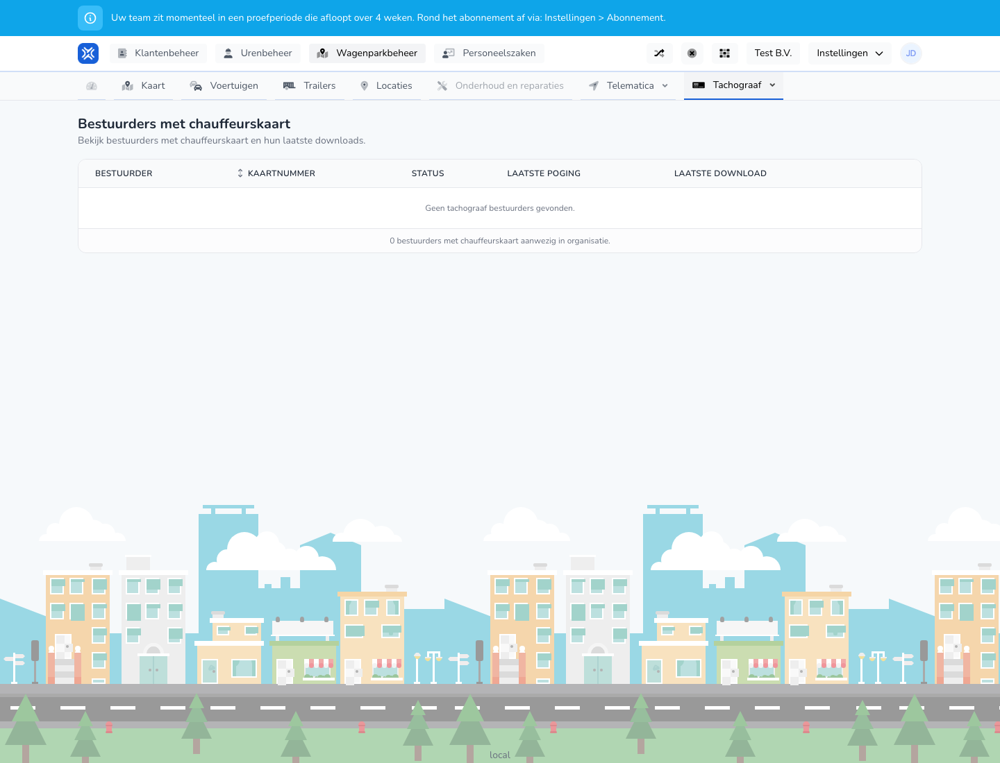

{/* translated-from: nl/management/fleet-management/tachograph/drivers.mdx sha256:96c9a6671ab024e92bfa5b673514fe79156ba0616f424ea08bf9bb5982f8caa1 */}

## What this page is for

On this page you see drivers with a driver card and their latest download moments.

## What you can do here

- View drivers and card numbers.
- Check the download status.

## Screenshot

## What you see on the page

- A table with driver, card number, status, last attempt and last download.

## How to use this page

1. Open **Drivers with a driver card**.
2. Check per driver whether the download status is up to date.
3. Use the card number and name to recognize the right driver.

## What happens next

- You see right away which drivers still need attention.

## Good to know

- Mainly use this page for checking and follow-up.

## Related pages

- Tachograph vehicles
- Tachograph company cards

