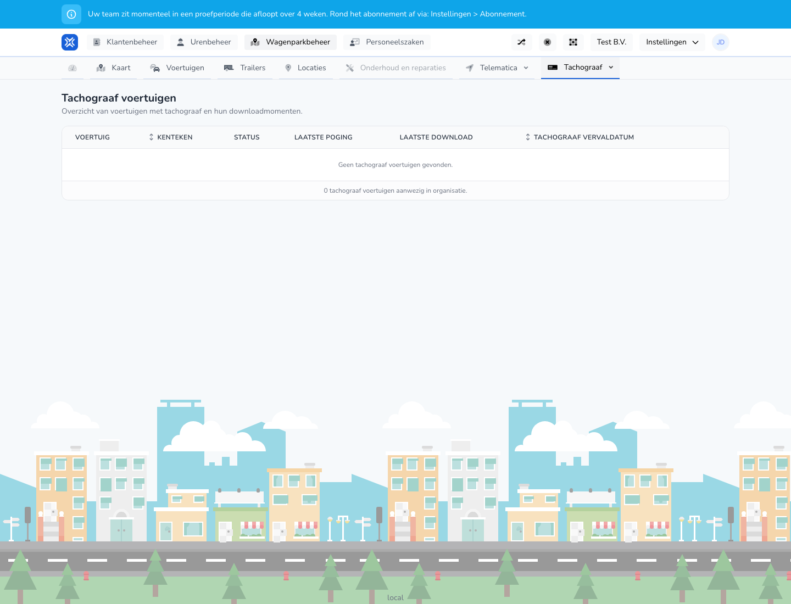

{/* translated-from: nl/management/fleet-management/tachograph/vehicles.mdx sha256:1abe3a22ad07449ebcc46e1b125a41a709dd2d4e378b4ab8aa5ea7e091ea6616 */}

## What this page is for

Here you see, for vehicles with tachograph information, when a download was attempted or succeeded.

## What you can do here

- Check which vehicles have tachograph data.
- View download moments and status.

## Screenshot

## What you see on the page

- A table with vehicle, license plate, status, last attempt, last download and expiry date.

## How to use this page

1. Open **Tachograph vehicles**.
2. Check the status column.
3. Then look at the last attempt and last download to see whether data was updated recently.

## What happens next

- You know which vehicles still need attention for tachograph downloads.

## Good to know

- Empty or old download moments often call for an extra check.

## Related pages

- Tachograph drivers
- Tachograph company cards

