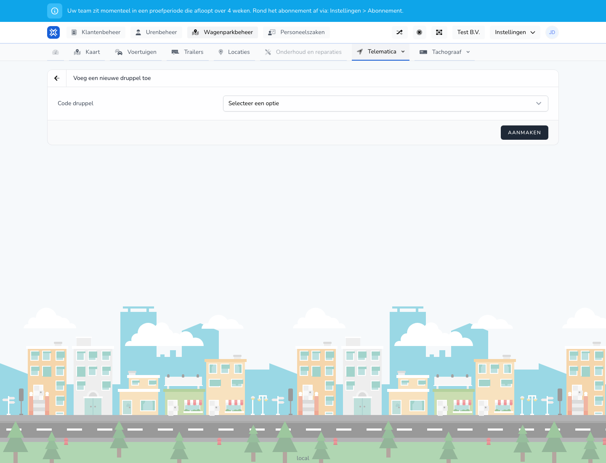

{/* translated-from: nl/management/fleet-management/telematics/beacons/create.mdx sha256:db3135f9769b74c2c1cdf48e3f0b1dfac635fe2ca0ea113590d533ad618c90b2 */}

## What this page is for

With this form you add a new beacon.

## What you can do here

- Choose or fill in the beacon code.
- Save the beacon.

## Screenshot

## What you see on the page

- The **Add a new beacon** screen.
- A field for the beacon code.
- The **Create** button.

## How to use this page

1. Open **Add beacon**.
2. Enter or choose the right code.
3. Click **Create**.

## What happens next

- The beacon appears in the overview.
- You can then link the beacon to a worker or trailer.

## Good to know

- Use the right code to prevent duplicate or wrong links.

## Related pages

- Beacons overview
- Link beacon

