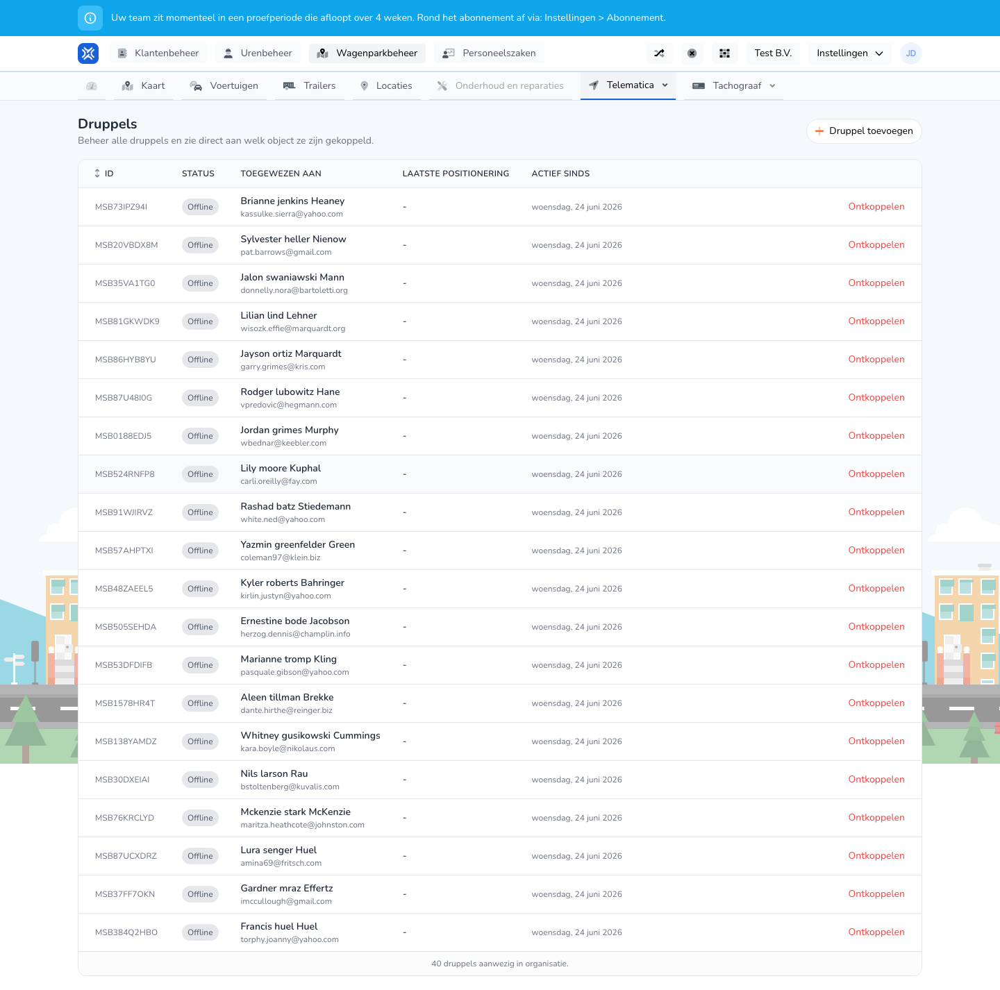

{/* translated-from: nl/management/fleet-management/telematics/beacons/overview.mdx sha256:4f366e4b6e5a6d78326b3d97ec01fa3524a40979aa74b911d82a8a3fa4a5109d */}

## What this page is for

Here you see all beacons, their status and which object they are linked to.

## What you can do here

- View beacons.
- Add a beacon.
- Check whether a beacon is already linked.

## Screenshot

## What you see on the page

- The **Add beacon** button.
- A table with ID, status, assigned to, last positioning and active since.

## How to use this page

1. Open **Beacons**.
2. Find the right beacon in the table.
3. Check whether the beacon is already linked.
4. Add a new beacon if it is still missing.

## What happens next

- You see which beacons still need attention.

## Good to know

- Unlinked or offline beacons stand out here right away.

## Related pages

- Add beacon
- Link beacon

