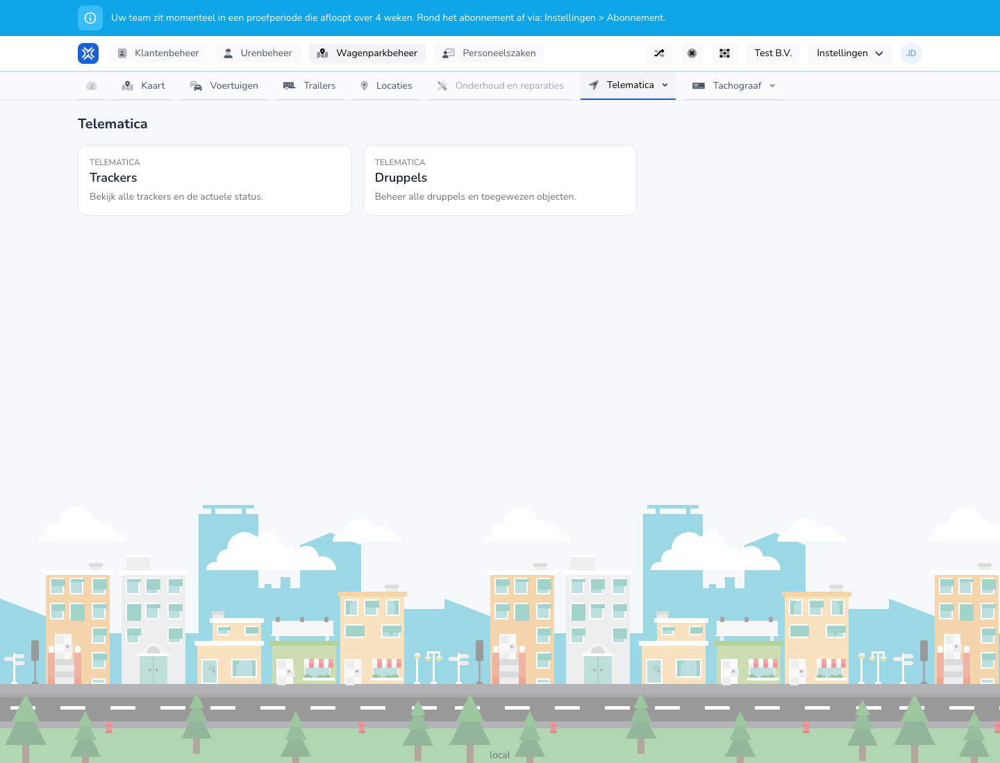

{/* translated-from: nl/management/fleet-management/telematics/overview.mdx sha256:40c0fe7135e6fd87d57b6f3b53e74856ba764381f6d6f00be80f5868d7a79263 */}

## What this page is for

On this page you choose whether to continue with trackers or with beacons.

## What you can do here

- Go to the trackers overview.
- Go to the beacons overview.

## Screenshot

## What you see on the page

- Two clear tiles or blocks: **Trackers** and **Beacons**.
- A short explanation for each section.

## How to use this page

1. Open **Telematics**.
2. Choose **Trackers** if you want to manage vehicle trackers.
3. Choose **Beacons** if you want to manage or link beacons.

## What happens next

- You go to the telematics section you chose.

## Good to know

- Use this screen as the starting point within telematics.
- You find the actual management actions on the following screens.

## Related pages

- Trackers overview
- Beacons overview

