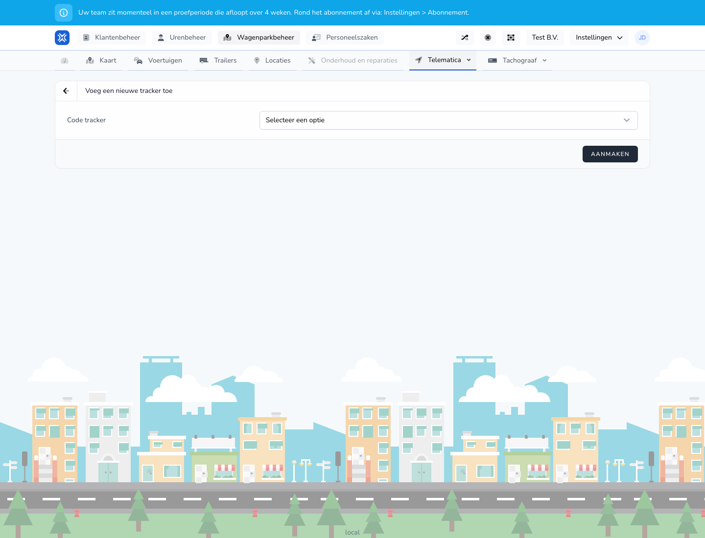

{/* translated-from: nl/management/fleet-management/telematics/trackers/create.mdx sha256:983178bf31db5dc6615bf8359e10c287fd6cdc6c427a04cd0ae1c1a4390d9cc7 */}

## What this page is for

With this form you add a tracker.

## What you can do here

- Choose or fill in the tracker code.
- Save the tracker.

## Screenshot

## What you see on the page

- The **Add a new tracker** screen.
- A field for the tracker code.
- The **Create** button.

## How to use this page

1. Open **Add tracker**.
2. Enter or choose the right tracker code.
3. Click **Create**.

## What happens next

- The tracker appears in the overview.
- You can then check the status and link.

## Good to know

- Use the right tracker code to prevent confusion later.

## Related pages

- Trackers overview

