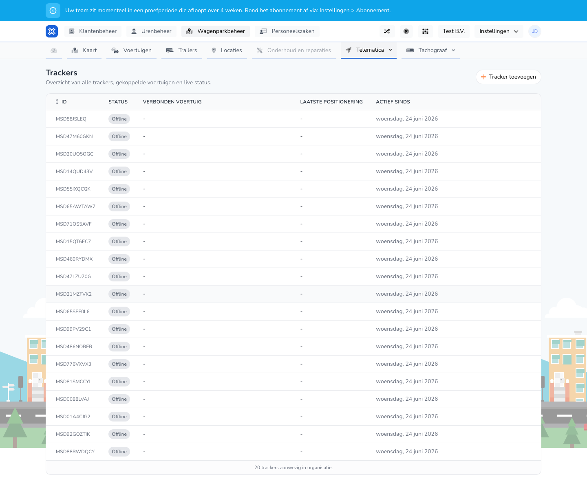

{/* translated-from: nl/management/fleet-management/telematics/trackers/overview.mdx sha256:54b7030ce8c89a4e455e01dff1272d4460b484fad4d0f46dfe65eac12c6f3350 */}

## What this page is for

Here you see all trackers, their status and which vehicle they are linked to.

## What you can do here

- View trackers.
- Add a tracker.
- Check status information.

## Screenshot

## What you see on the page

- The **Add tracker** button.
- A table with ID, status, connected vehicle, last positioning and active since.

## How to use this page

1. Open **Trackers**.
2. Check the status of the trackers.
3. Use **Add tracker** if a new tracker is still missing.

## What happens next

- You know which trackers are active and which vehicle they are fitted to.

## Good to know

- Pay particular attention to offline statuses and missing vehicle links.
- Use this overview to spot technical signals quickly.

## Related pages

- Add tracker
- Telematics overview

