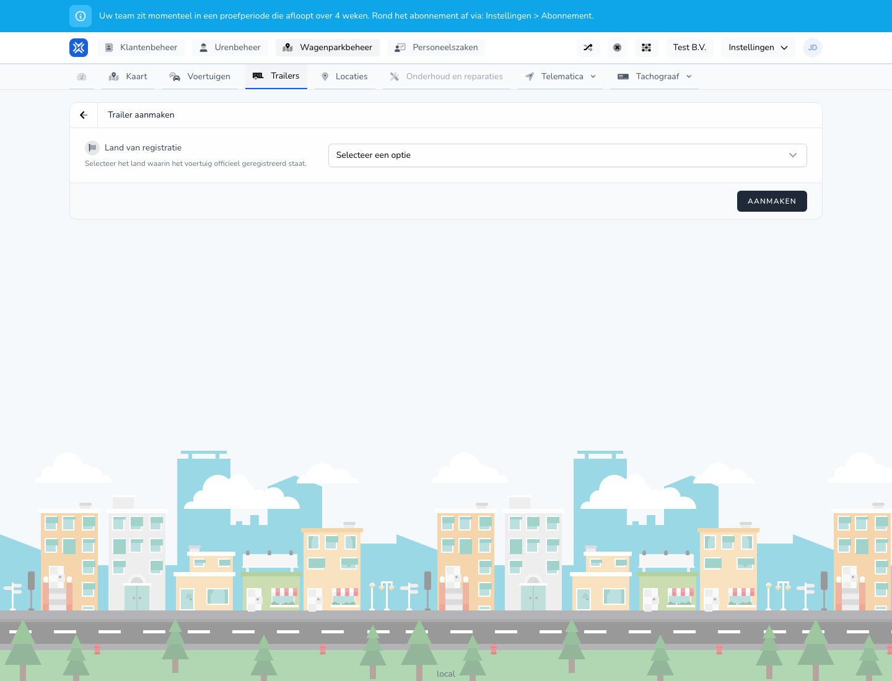

{/* translated-from: nl/management/fleet-management/trailers/create.mdx sha256:a612cf08b6fbf4a106b6ea4b034d6336f02b22ca2b02216d9ac40fff4701f225 */}

## What this page is for

With this form you add a new trailer.

## What you can do here

- Record the country of registration.
- Register the trailer for further use in the system.

## Screenshot

## What you see on the page

- The **Create trailer** screen.
- A choice for the country of registration.
- The **Create** button.

## How to use this page

1. Open **Trailers** and choose **New vehicle**.
2. Choose the right country of registration.
3. Fill in the other trailer details as soon as they are visible.
4. Click **Create**.

## What happens next

- The trailer is added to the overview.
- The trailer can then be used in other fleet processes.

## Good to know

- Use the trailer's official registration details.
- After saving, check that the trailer appears in the overview.

## Related pages

- Trailers overview
- Edit trailer

