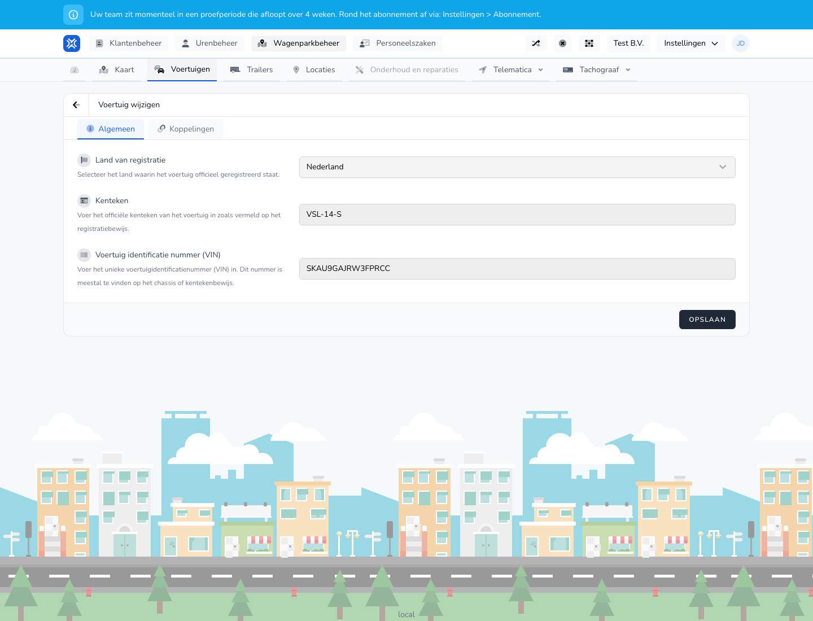

{/* translated-from: nl/management/fleet-management/vehicles/edit.mdx sha256:85343e130739b1c079b1d0d7b1d7c7ba84cb20d6aac85476dff698f5fe7beccf */}

## What this page is for

With this page you change the details of an existing vehicle.

## What you can do here

- Change registration and vehicle details.
- Review checkpoints and links.

## Screenshot

## What you see on the page

- The **Edit vehicle** screen.
- The same main sections as when creating, such as **General** and **Assignments**.
- Vehicle details that are already filled in.

## How to use this page

1. Open the vehicle via **Edit** in the overview.
2. Only change the fields that need to change.
3. After a change, always check the license plate, country and other identification details.
4. Save the changes.

## What happens next

- The changed details become visible in the vehicles overview.
- Other screens that use this vehicle then show the new information.

## Good to know

- Work carefully, because vehicle details can appear in several places.
- After saving, check that the change was processed correctly in the overview.

## Related pages

- Vehicles overview
- Create vehicle

