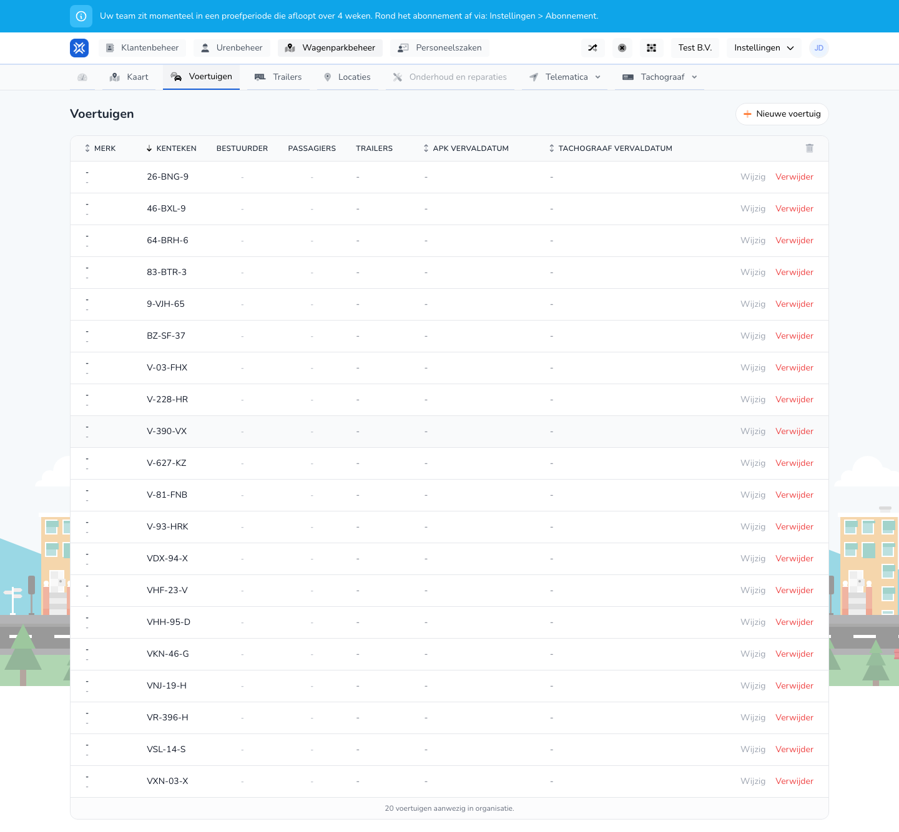

{/* translated-from: nl/management/fleet-management/vehicles/overview.mdx sha256:df0b53871e7802ca7b569d316db71b20ff80ac2dc8585ca85636d24d0f67fc0b */}

## What this page is for

Here you manage your organization's vehicles. For each vehicle you see the most important details and the available actions.

## What you can do here

- View vehicles.
- Create a new vehicle.
- Change or delete an existing vehicle.

## Screenshot

## What you see on the page

- The **New vehicle** button.
- A table with columns such as make, license plate, driver, passengers and expiry dates.
- Actions such as **Edit** and **Delete** per row.

## How to use this page

1. Open **Vehicles** in Fleet management.
2. Find the right vehicle in the table.
3. Click **Edit** if you want to change details.
4. Click **New vehicle** if you want to enter an extra vehicle.
5. Only use **Delete** when the vehicle is no longer actively used.

## What happens next

- After opening **Edit**, you go to that vehicle's edit form.
- After **New vehicle**, the form to enter vehicle details opens.
- After deleting, the vehicle disappears from the active overview.

## Good to know

- Check the license plate and expiry dates carefully before you save.
- Use this overview as the starting point for almost all vehicle management actions.

## Related pages

- Create vehicle
- Edit vehicle
- Map

