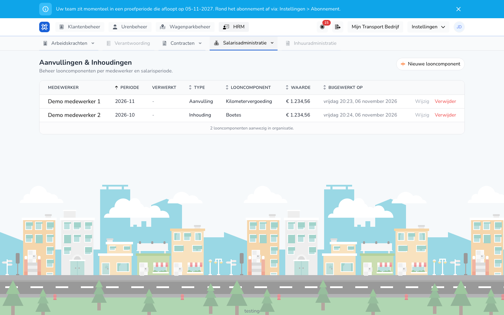

{/* translated-from: nl/management/human-resources/payroll-components/overview.mdx sha256:df5f92848b99f94f979811bd40269c1fca2471937be026975560b1967afc0b31 */}

import { Hint } from '/snippets/hint.jsx';

## What this page is for

Here you manage amounts that you add to or deduct from the pay separately from the hours, such as a mileage allowance, an advance or a fine. Such an amount is called a pay component.

## Screenshot

## Who can use this

- An administrator with full rights in the organization.
- The organization needs the **Payroll inputs** module.

## How to use this page

1. Open **HR** and choose **Payroll administration**.
2. Click **Additions & Deductions**.
3. For each line, view the worker, the period and the amount.
4. Click **New pay component** to add an amount. See [Create pay component](/en/management/human-resources/payroll-components/create).
5. Click **Edit** or **Delete** in a pay component's row. See [Edit pay component](/en/management/human-resources/payroll-components/edit).

## Fields

| Column | Meaning |
|-------|-----------|
| **Worker** | The worker who receives or gives up the amount. |
| **Period** | The payroll period, for example 2026-10. |
| **Processed** | The status of the payroll run that paid out the amount. A dash means that has not happened yet. |
| **Type** | **Addition** or **Deduction**. |
| **Pay component** | The kind of amount, such as **Mileage allowance** or **Fines**. |
| **Value** | The amount. |
| **Updated on** | When the pay component was last saved. |

## What happens next

- A pay component counts in the payroll run of its period. If that run is a draft or locked, it is recalculated right away. <Hint kind="grey">You do not have to run the run again yourself for that.</Hint>
- If that run has already been processed, it gets the status **Corrected**. The amount then goes along with a correction. See [Corrections on a payroll run](/en/management/human-resources/payroll-runs/corrections).

## Limitations

- The overview has no filters and no search field.
- **Delete** asks for confirmation and then removes the pay component right away. <Hint kind="red">You cannot restore a deleted pay component. If it belongs to a processed run, the run is checked again for corrections.</Hint>
