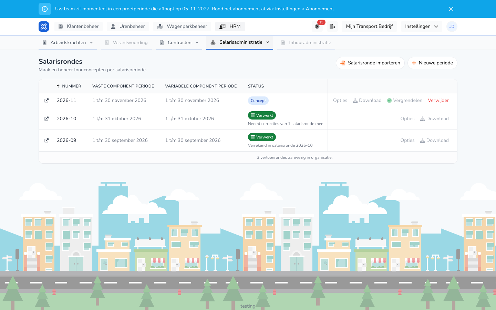

{/* translated-from: nl/management/human-resources/payroll-runs/overview.mdx sha256:05ac2c05a7be3b86b8cd95b8d5d4be04086c5a41eb5ebf7394d77dc2f02203b9 */}

## What this page is for

Here you see all payroll runs of your organization, with the pay period and the status of each run. From this overview you create a new run, process a run and download the exports.

## Screenshot

## Who can use this

- An administrator with full rights in the organization.
- The organization needs the **Payroll inputs** module. Without that module, **Payroll runs** is not in the menu.

## How to use this page

1. Open **HR** and choose **Payroll administration**.
2. Click **Payroll runs**.
3. Find the run in the overview. The newest run is at the top.
4. Use the buttons in the run's row. **Options** and **Download** open a list.
5. Click the icon in front of the number to open the run's details.
6. Click **New period** to create a run. See [Create payroll run](/en/management/human-resources/payroll-runs/create).

## Fields

The overview has no filters. Each row shows:

| Column | Meaning |
|-------|-----------|
| **Number** | The number of the run, for example 2026-10. |
| **Fixed component period** | The period of the fixed pay components. |
| **Variable component period** | The period of the variable pay components. |
| **Status** | Where the run stands, see below. |
| **Last run on** | When the run was last calculated. |

A run has one of these statuses:

| Status | Meaning |
|--------|-----------|
| **Draft** | The run has been calculated and can still be changed. |
| **Running** | A task is running, such as a calculation or an analysis. The percentage keeps pace. |
| **Locked** | The run is locked and ready to be completed. |
| **Processed** | The run has been processed. |
| **Corrected** | A difference was found after processing. See [Corrections](/en/management/human-resources/payroll-runs/corrections). |
| **Failed** | The task did not succeed. |

Below the status you may also see:

- `Neemt correcties van 1 salarisronde mee`: this run has carried the correction of an older run.
- `Verrekend in salarisronde` with a number: this run's correction was paid in that newer run. The text is a link to that run.

The buttons in a row depend on the status:

| Button | When |
|------|---------|
| **Options** → **Run again** | For a draft. |
| **Options** → **Unlock** | For a locked run. |
| **Options** → **Analyze for corrections** | For a processed or corrected run. |
| **Lock** | For a draft. |
| **Complete** | For a locked or corrected run. See [Process payroll run](/en/management/human-resources/payroll-runs/process). |
| **Download** | Shows the exports that are ready for the run. See [Exports of a payroll run](/en/management/human-resources/payroll-runs/exports). |
| **Delete** | For a draft or a locked run. |

## What happens next

- The overview refreshes itself while a task is running.
- **Lock** first asks for confirmation in the **Lock payroll run** window. Then the run is recalculated and gets the status **Locked**.
- **Delete** first asks for confirmation in the **Delete payroll run** window.

## Limitations

- You cannot delete a locked run. Unlock the run first with **Options** → **Unlock**.
- You cannot delete a processed or corrected run.
- While a run's task is running, wait until it is finished before you start a new action on that run.
- With **Import payroll run**, you put a previously made payroll input export (.xlsx) into a run as its result. The hours are then not calculated again.
