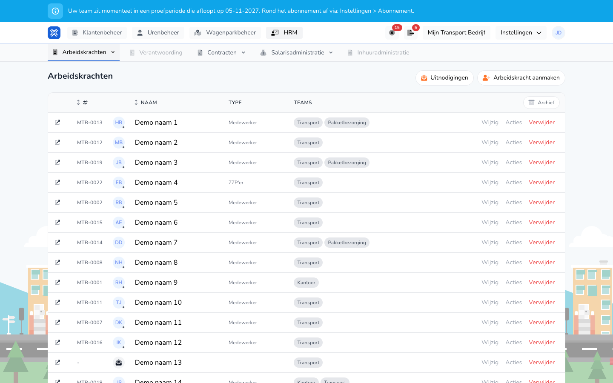

{/* translated-from: nl/management/human-resources/workers/overview.mdx sha256:629d4cf0cedc554799d3a0dd9d2c3cde9099c080506260a000232beed05b452a */}

## What this page is for

Here you view and manage your organization's workers.

## What you can do here

- View workers.
- Add a new worker.
- Change a worker, open actions or delete.

## Screenshot

## What you see on the page

- The **New worker** button.
- A table with name, type, contract hours and contract end.
- Actions such as **Edit**, **Actions** and **Delete**.

## How to use this page

1. Open **Personnel**.
2. Find the worker you need.
3. Use **Edit** to change details.
4. Use **New worker** to add someone.

## What happens next

- Changes are processed in the workers overview.
- New workers then appear in the list.

## Good to know

- Check the contract details especially carefully.
- Use the row actions to carry out follow-up actions.

## Related pages

- Dashboard
- Accountability overview

